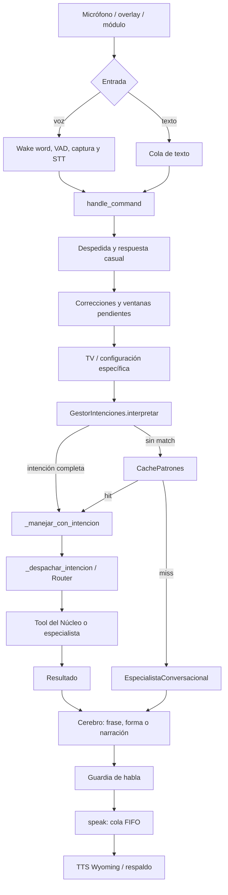

# D.A.R.K. — Arquitectura Maestra

**Fuente de referencia consolidada del proyecto**
**Estado:** revisado contra el árbol de código el 22 de noviembre de 2026
**Código Python principal:** `dark_python/`
**Runtime principal:** Windows · Python 3.10+ · Ollama local · Wyoming para voz

Este documento resume la arquitectura y el estado observado en el código. Las
mediciones puntuales no son garantías de rendimiento; los planes y contratos
históricos se identifican como diseño cuando no equivalen a comportamiento
implementado. Si hay discrepancia, el código y la configuración vigentes mandan.

La estructura vigente de paquetes y proveedores se detalla en
[`arquitectura_paquetes_y_proveedores.md`](arquitectura_paquetes_y_proveedores.md).
Ese documento refleja los paquetes por dominio, el puerto de STT local y el
contrato de chat que el Núcleo y los especialistas consumen sin formar payloads
Ollama directamente.

## Estado del runtime y distribución (22/11/2026)

El repositorio contiene dos modos de ejecución. El modo local de desarrollo
conserva el arranque desde `dark_python/nucleo/dark_nucleo.py` y los scripts BAT.
El modo instalado inicia desde `DarkManager/DarkSupervisor`: el Supervisor lee
la configuración, prepara los servicios configurados y delega el ciclo de vida
al host externo mediante `DARK_PROCESS_OWNER=external`. En ese modo el Núcleo
no inicia ni detiene por su cuenta los procesos que pertenecen al Supervisor.
La aplicación de escritorio está separada en servidor UI Node/TanStack y shell
Electron.

`config/runtime.json` centraliza perfil, rutas, endpoints, modelos y keep-alive;
`config/runtime.schema.json` publica el esquema y `dark_python/config_runtime.py`
valida la estructura al cargarla. `DARK_RUNTIME_CONFIG` permite seleccionar
otro archivo. Hay campos de configuración propios de cada subsistema que
siguen teniendo su resolución específica.

`DarkSetup` aporta detección de hardware, selección/provisión de modelos y
descarga/extracción de artefactos. `DarkInstaller` presenta el flujo de
instalación, reparación y desinstalación y contiene validaciones de metadatos
distintas para los canales Release y Tester. Las compuertas de publicación
requieren manifiesto, payload, avisos y condiciones coherentes; su presencia no
significa que exista una versión Release ya publicada. El alcance inspeccionado
y sus límites están en [`M0_INVENTORY.md`](../M0_INVENTORY.md).

## Índice

1. [Propósito y principios](#1-propósito-y-principios)
2. [Mapa arquitectónico del sistema](#2-mapa-arquitectónico-del-sistema)
3. [Capa de intención](#3-capa-de-intención)
4. [Contexto y memoria](#4-contexto-y-memoria)
5. [Identidad, conversación y voz](#5-identidad-conversación-y-voz)
6. [Router, especialistas y herramientas](#6-router-especialistas-y-herramientas)
   - [Terminal segura](#64-terminal-segura)
7. [Latencia y recursos](#7-latencia-y-recursos)
8. [Estado de fases y esqueletos](#8-estado-de-fases-y-esqueletos)
9. [Límites y validación](#9-límites-y-trabajo-de-validación)
10. [Documentos de referencia y precedencia](#10-documentos-de-referencia-y-precedencia)

---

## 1. Propósito y principios

D.A.R.K. es un asistente local que recibe texto o voz, interpreta la petición,
mantiene contexto, decide si debe conversar o actuar y enruta las acciones a
capacidades del Núcleo, especialistas o módulos conectados.

Principios vigentes:

- **Modularidad:** el Núcleo coordina; los especialistas concentran familias
  de capacidades y las herramientas declaran sus parámetros en un manifiesto.
- **Local-first:** la conversación principal usa Ollama local. Algunas
  herramientas, como búsqueda web y ciertos servicios de traducción, requieren
  conexión externa.
- **Una personalidad común:** Cerebro y Personalidad dan forma a las respuestas
  de las distintas rutas. Los especialistas producen resultados, no identidades
  independientes.
- **Acción verificable:** no se confirma éxito sin resultado. Las acciones
  sensibles pueden requerir confirmación; las correcciones y relaciones se
  conservan en el estado de intención.
- **Identidad adaptable, no absoluta:** las tendencias conductuales modulan el
  tono y la longitud; los invariantes de comunicación siguen siendo límites.
- **Recursos y latencia medidos:** los timeouts deben respetar el presupuesto del
  turno. El rendimiento depende del modelo residente, el prefijo de Ollama, el
  CPU y la memoria disponibles.

---

## 2. Mapa arquitectónico del sistema

### 2.1 Punto de entrada y arranque

Desde `dark_python/`, el arranque de producción es:

```text
python -m nucleo.dark_nucleo
```

El bloque `__main__` ajusta la salida de consola a UTF-8 y construye
`DarkNucleo`. Su inicialización crea Cerebro, especialistas, GestorIntenciones,
GestorEntidades, CachePatrones, clientes de voz, overlay y conexiones de módulos;
después inicia `run_assistant()`. Si está configurado el micrófono persistente,
el Núcleo conserva abierto el stream, escucha la wake word y entrega turnos al
worker de voz. Si ese modo falla, pasa al bucle clásico.

Hilos y workers principales que inicia el Núcleo (según la ruta y configuración
disponibles):

| Worker | Responsabilidad |
|---|---|
| `tts-habla` | Consume la cola FIFO de habla y reproduce el audio fuera del hilo de comandos. |
| `voz-turnos` | Procesa turnos detectados por el micrófono persistente. |
| `tareas_bg` | Ejecuta tareas largas asociadas a intenciones. |
| Cola de texto | Atiende entradas de texto procedentes del overlay y otras interfaces. |
| Precalentamiento de voz/modelo | Prepara la tubería de audio y Ollama en segundo plano. |
| Sondeo de recursos y tareas | Actualiza estado de recursos, tareas e interrupciones. |
| Afinidad de CPU | Revisa periódicamente la afinidad configurada. |
| Overlay y módulos | El bridge gráfico, Hub/cliente coordinador y bridge de TV se inician según configuración. |

También reanuda tareas pendientes si `AUTO_RETOMAR_TAREAS` está activado, y ya no es una
rutina que camine sola: `_programar_retomar_tareas` levanta un hilo (`retomar-tareas`)
**solo** en el borde bloqueado→concedido del acceso y ese hilo duerme hasta la siguiente
concesión, así que hay una pasada por concesión real, no un sondeo periódico. Los workers
no implican que todas las capacidades sean paralelas: las intenciones compuestas se
despachan secuencialmente.

### 2.2 El viaje del texto



Orden de alto nivel en `handle_command`: serialización del turno con
`_command_lock`; preferencias de comunicación; despedida y respuesta casual;
olvido de una frase recién corregida de la caché; tratamiento de tareas largas y
acciones rápidas pendientes; configuración/control de TV; respuesta a avisos de
música; intérprete; caché de patrones aprendidos; conversación como último
recurso. El `finally` registra el turno en temas cuando hace falta y captura
menciones de aplicaciones para referencias futuras.

### 2.3 Capa de entrada y voz

| Componente | Papel actual |
|---|---|
| `voz/micro.py` | Captura PCM, VAD, endpointing y detección de barge-in. |
| `herramientas/internas/wake_word.py` | Detecta wake word sobre audio; no interpreta el texto. |
| `voz/stt.py` / `voz/cliente.py` | Cliente de Wyoming para transcripción y transporte de audio. |
| `nucleo/dark_nucleo.py:transcribir` | Orquesta STT y normaliza/corrige la transcripción. |
| `proveedores/llm/contrato.py` y `proveedores/llm/ollama.py` | Contrato común de chat y adaptador de streaming/respuestas completas para Ollama. |
| `modulos/dark_overlay_bridge.py` | Integra texto/eventos del overlay. |
| `voz/tts.py` y `voz/cliente.py` | Síntesis y streaming de audio Wyoming; existen respaldos locales/remotos según configuración. |
| `dark_nucleo.py:speak` | Punto de salida: registra el texto y lo pone en cola; no decide personalidad. |

Wyoming usa normalmente ASR en el puerto 10300 y TTS en 10200. La configuración
del servidor, voz, modelos y micrófono vive en `voz/config.py` y
`voz/supervisor.py`.

### 2.4 Capas de contexto

`temas.py` y `contexto.py` responden preguntas distintas y no son
intercambiables:

| Pieza | Qué representa | Datos y consumidores |
|---|---|---|
| `nucleo/memoria/temas.py` (`GestorContexto`) | Continuidad semántica de la conversación: línea activa, líneas secundarias, objetivo, decisiones, pendientes, datos y relaciones entre temas. | El especialista conversacional lo procesa y genera un bloque de temas para el prompt. Es memoria de conversación, no monitor del escritorio. |
| `nucleo/memoria/contexto.py` (`ContextoSesion`, `Memoria`) | Estado de sesión y señales locales: app en primer plano, actividad/inactividad, duración, ausencias, pedidos, música y hechos recordados. | Cerebro lo proyecta como contexto dinámico; la intención puede usar estado de sesión para referencias como “cierra eso” o “ponla otra vez”. Persiste en JSON local con escrituras atómicas. |
| `nucleo/intenciones/entidades.py` (`GestorEntidades`) | Entidades nombradas recientemente (app, archivo, música, módulo) y resolución de referencias. | La intención lo consulta antes del match; TTL de 40 turnos, máximo 20 por tipo. |
| `nucleo/intenciones/cache_patrones.py` (`CachePatrones`) | Frases que no cubrían las reglas y que un LLM ya resolvió a una herramienta. | Se consulta después de intención y antes del conversacional; TTL de 30 días y hasta 100 entradas, con hook de olvido cuando se corrige un hit reciente. |

La actividad en pantalla tiene una salvaguarda: si la inactividad supera
`INACTIVIDAD_MAX_S` (120 s), esa app no se contabiliza como actividad actual.
Los temas pueden informar el prompt conversacional; la sesión aporta estado
operativo. No se debe inferir un estado emocional a partir de ninguna de las dos.

### 2.5 Arquitectura conceptual objetivo

La arquitectura se organiza en cuatro secciones sustituibles. Esta es la
dirección de diseño; no significa que todos los límites ya estén aplicados en
el código actual.

| Sección | Propósito y propiedad | Límite de sustitución |
|---|---|---|
| **Voz** | Todo el ciclo de habla directa: entrada de audio, wake word, captura, VAD, STT, interrupción, TTS y reproducción. Es dueña de sus proveedores de audio. | Entrega texto/eventos normalizados al Núcleo y recibe texto/órdenes de reproducción. No interpreta intención ni contiene personalidad. |
| **Núcleo** | La mente conversacional: personalidad, contexto necesario, interpretación, diálogo y políticas para decidir cuándo usar una herramienta. `dark_nucleo` debe quedar como orquestador de turnos y herramientas, no como dueño de implementaciones concretas. | Usa contratos de herramientas, voz y sistema de módulos; no importa adaptadores concretos ni realiza su I/O directamente. |
| **Herramientas** | Catálogo y ejecución normalizada de capacidades que el asistente ofrece: terminal, archivos, web, traducción, código y otras herramientas. Cada herramienta define entrada, resultado, errores, permisos y dependencias. | El Núcleo selecciona una herramienta mediante su contrato. El reemplazo de una implementación conserva el contrato y sus pruebas de conformidad. |
| **Sistema de módulos** | Infraestructura para descubrir, registrar, comunicar y enrutar a módulos heterogéneos, por ejemplo TV, teléfono y Hive. Cada módulo posee sus protocolos, configuración, estado y dependencias específicos. | El sistema coordina módulos por capacidades y mensajes versionados; no importa internals de TV, teléfono u otro módulo. Deshabilitar o retirar uno no debe impedir iniciar ni usar los demás. |

El flujo de control esperado es:

```text
Voz / interfaz de texto
        ↓ texto y eventos
Núcleo: contexto → conversación/decisión → selección de capacidad
        ↓ contrato
Herramienta o Sistema de módulos
        ↓ resultado normalizado
Núcleo: respuesta con personalidad
        ↓ texto a decir
Voz
```

Reglas para que esa independencia sea comprobable:

1. Las dependencias entre secciones pasan por contratos estables y versionados;
   no se importan clases internas de otra sección.
2. Los adaptadores y proveedores se construyen en puntos de composición
   explícitos. Importar un paquete o deshabilitar una capacidad no debe iniciar
   procesos, abrir dispositivos ni requerir dependencias opcionales.
3. Cada componente es dueño de su configuración, persistencia, errores y
   recursos. Compartir datos requiere un contrato, no acceso a archivos o estado
   privado de otro componente.
4. La ausencia o fallo de una integración opcional se expresa como capacidad no
   disponible y no debe inutilizar el Núcleo, la voz restante ni módulos ajenos.
5. Cada implementación intercambiable tiene pruebas de contrato; cada sección
   tiene pruebas de arranque sin sus extras y de degradación cuando un
   componente está ausente.

El objetivo no es que cada sección carezca de dependencias, sino que sus
dependencias externas estén declaradas y detrás de puertos, y que retirar una
implementación concreta no obligue a modificar consumidores no relacionados.

---

## 3. Capa de intención

### 3.1 Responsabilidades y dependencias

`nucleo/intenciones/gestor.py` contiene `GestorIntenciones`, las capacidades del
Núcleo, el match y la construcción de intenciones, las relaciones entre turnos,
la confirmación, la persistencia y el historial corto. Antes del match usa
`normalizador.py`; consulta contexto de sesión, contexto de temas y
`GestorEntidades` para completar referencias; usa
`matcher_palabras_clave.py` como matcher único de capacidades; finalmente el
Núcleo consulta CachePatrones si no hubo match.

`entidades.py` no es la caché de frases ni la memoria a largo plazo.
`cache_patrones.py` tampoco es memoria semántica: asocia ejemplos de texto
con herramientas ya resueltas.

### 3.2 Contrato de datos

Esquema simplificado de las dataclasses que forman el contrato actual:

```python
@dataclass
class Parametro:
    valor: Any
    origen: str = EXPLICITO  # EXPLICITO, INFERIDO o CONTEXTUAL

@dataclass
class Relacion:
    tipo: str
    intencion_id: str

@dataclass
class Intencion:
    id: str
    tipo: str
    objetivo: str
    action: str = ""
    parametros: dict[str, Parametro] = field(default_factory=dict)
    faltantes: list[str] = field(default_factory=list)
    estado: str = PENDIENTE
    lugar: str = "nucleo"
    relaciones: list[Relacion] = field(default_factory=list)
    confianza: float = 0.5
    texto_origen: str = ""
    peligrosa: bool = False
    background: bool = False
    alternativas: list[dict] = field(default_factory=list)
    estado_previo: Any = None
    estado_previo_musica: Any = None
    implicita: bool = False
```

La implementación real agrega contadores/fechas de turno, marcas temporales,
métodos de serialización y campos de contexto. Las capacidades se declaran con
patrones, parámetros requeridos/opcionales, resolutor, flags `peligrosa`,
`background`, lugar y reversibilidad (`auto`, `estado` o `no`). Hay 21
capacidades del Núcleo, listadas a continuación en el orden de
`CAPACIDADES_NUCLEO`, que es significativo para el desempate:

| # | Capacidad | Lugar |
|---:|---|---|
| 1 | `hora` | nucleo |
| 2 | `fecha` | nucleo |
| 3 | `abrir_archivo` | nucleo |
| 4 | `buscar_imagenes` | nucleo |
| 5 | `abrir_en_navegador` | nucleo |
| 6 | `investigar` (antes `buscar_web`) | nucleo |
| 7 | `buscar_archivo` | nucleo |
| 8 | `cambiar_nombre_archivo` | nucleo |
| 9 | `poner_wallpaper` | nucleo |
| 10 | `ajustar_volumen_musica` | nucleo |
| 11 | `detener_musica` | nucleo |
| 12 | `escribir_codigo` | nucleo |
| 13 | `escribir_documento` | nucleo |
| 14 | `seleccionar_resultado_web` | nucleo |
| 15 | `abrir_aplicacion` | nucleo |
| 16 | `cerrar_aplicacion` | nucleo |
| 17 | `reproducir_musica` | nucleo |
| 18 | `traducir_archivo` | nucleo |
| 19 | `accion_imagenes` | nucleo |
| 20 | `menu` | nucleo |
| 21 | `orden_modulo` | `module:*` |

`orden_modulo` es la única capacidad cuyo `lugar` no es `nucleo`: se declara con
`lugar="module:*"` porque su ejecución vive en los módulos conectados al Hive, no
en el Núcleo. El recuento de 20 es el que afirma
`tests/test_matcher_v3.py` (`assertEqual(len(CAPACIDADES_NUCLEO), 20)`).

Este recuento no debe confundirse con el de **herramientas** del MANIFEST
(`herramientas/internas/manifest_tools.py`), que son 18 y son otra cosa: varias
comparten nombre con una capacidad y actúan como su ejecución, y ocho no son
capacidades declaradas sino herramientas que solo alcanza el conversacional.

### 3.3 Tipos, estados y relaciones

Tipos de intervención principales: `accionable`, `deseo`, `necesidad`,
`comentario`, `ambiguo`, `sospecha` y `problema`. `ambiguo_pendiente` identifica
la intervención que espera un desempate explícito.

| Grupo | Valores vigentes |
|---|---|
| Estados vivos persistidos | `pendiente`, `en_progreso`, `incompleta`, `pospuesta`, `esperando_confirmacion` |
| Estados finales | `resuelta`, `cancelada`, `obsoleta`, `fallida` |
| Ambigüedad | `tipo="ambiguo_pendiente"`, estado de la intención `pendiente`, alternativas guardadas |
| Relaciones | `continuar`, `modificar`, `expandir`, `independiente`, `adicion`, `deshacer`, `no_deshacer`, `dependencia`, `paralelismo` |

Las intenciones vivas se escriben en `dark_intenciones.json`; el log se conserva
en `dark_intenciones_log.jsonl` con límite de 500 líneas. Las resueltas recientes
se guardan en un deque corto para poder interpretar correcciones posteriores.
Las capacidades peligrosas principales (`cerrar_aplicacion` y
`cambiar_nombre_archivo`) esperan confirmación. El Núcleo ejecuta el undo
declarado antes de despachar la acción nueva cuando la reversibilidad lo permite.

### 3.4 Qué hace y qué no hace la multi-intención

El intérprete puede separar frases compuestas y devolver una lista. El Núcleo
despacha sus acciones una tras otra, respetando el orden indicado. Una ventana
rápida de un segundo permite corregir acciones instantáneas antes de ejecutarlas;
las tareas largas tienen su propia ventana antes de entrar al worker.

Esto **no** equivale a paralelismo real ni a una cadena que conecte la salida del
paso anterior con el siguiente. Aunque existan relaciones y conectores llamados
`paralelismo` o `dependencia`, aún no hay ejecución concurrente ni transferencia
general de resultados entre pasos. “Pon música y baja el volumen” se resuelve
secuencialmente; “haz ambas mientras tanto” no garantiza concurrencia.

### 3.5 Versiones de intención

| Línea | Estado contrastado |
|---|---|
| V1 | Cerrada: normalización, capacidades base, faltantes, confirmación, persistencia y log. |
| V2.1 | Cerrada: contexto al conversacional y referencias de sesión. |
| V2.2 | Cerrada: entidades, menciones, referencias sin verbo, ambigüedad en fases, correcciones e histórico corto. |
| V2.3 | Cerrada: relaciones, reversibilidad, undo y adición. Multi-intención secuencial. |
| V2.4 A/B | Cerrada: fix de búsqueda de archivos, caché de patrones y hook de olvido. |
| V2.5 | Cerrada: cancelación/corrección rápida y larga antes de despachar/encolar. |
| V2.6 / 2.7 | Cerradas: avisos de duración de música y respuesta al fin natural de canción. |
| Matcher V3 | Matcher único de capacidades; V2 y `DARK_MATCHER_V3` retirados. |

---

## 4. Contexto y memoria

### 4.1 Memoria disponible hoy

La memoria persistente actual está distribuida por propósito:

| Archivo / sistema | Contenido y límite |
|---|---|
| `nucleo/memoria/dark_memoria.json` (`ContextoSesion.Memoria`) | Contadores de sesiones, apps, canciones, artistas, herramientas, horas de inicio y hechos que el usuario pidió recordar. |
| `nucleo/memoria/dark_temas.json` y su log | Temas, objetivos, estado, decisiones, pendientes, hallazgos, relevancia y relaciones; el gestor incluye evolución de temas paralelos, intersecciones y nudos. |
| `nucleo/intenciones/dark_entidades.json` | Memoria operacional corta de entidades, TTL de 40 turnos. |
| `nucleo/intenciones/dark_intenciones.json` y log | Intenciones vivas y sus transiciones, incluyendo confirmaciones/ambigüedades pendientes. |
| `nucleo/intenciones/dark_cache_patrones.json` | Mapeos de frase a herramienta aprendidos desde la ruta de selección de tool; TTL de 30 días, máximo 100 entradas. |
| `nucleo/identidades/dark_perfil_conductual.json` | Tendencias de comunicación; actualización máxima de ±0,05 por interacción, decaimiento gradual y guardado atómico. |

### 4.2 Memoria a largo plazo: alcance exacto

Hay persistencia local real y recuperación de hechos recordados, métricas de uso,
contextos temáticos y perfil conductual. Sin embargo, **no existe todavía un
servicio unificado de memoria de largo plazo** con clasificación de recuerdos de
usuario/proyecto/operación/aprendizaje, política de retención y recuperación
selectiva común. `dark_entidades` y la caché de patrones son piezas acotadas y no
deben describirse como tal sistema. Esta es una distinción importante para la
siguiente línea de trabajo.

---

## 5. Identidad, conversación y voz

### 5.1 Identidad conductual

`perfil.py` guarda las tendencias `cercania`, `iniciativa`, `brevedad`,
`profundidad`, `seriedad`, `paciencia`, `espontaneidad` y `humor` (base 0). Una
interacción no cambia una tendencia más de ±0,05. Tras días sin interacción,
decaen hacia su base. Los estados emocionales expresados no se convierten en
etiquetas permanentes.

`nucleo/identidades/cerebro.py` combina invariantes, directrices derivadas del perfil y
contexto dinámico para solicitudes al LLM. `personalidad.py` implementa la
selección de frases y formas de respuesta; `frases.py` contiene los bancos.
`nucleo/identidades/guardia.py` filtra texto antes de hablar: sanea formas de tuteo conocidas,
retira nombres identificados, evita afirmaciones infundadas sobre estados
internos y corrige cierres/fragmentos definidos por sus reglas. El filtro es
determinista y no sustituye la evaluación de seguridad de una acción.

### 5.2 Flujo híbrido de habla

| Caso | Comportamiento vigente |
|---|---|
| Antes de abrir una aplicación o buscar en la web | `pre_accion`: banco local de 17 variantes, seleccionado mediante Cerebro/Personalidad y con historial de tres para evitar repeticiones recientes. `speak` lo pone primero en la cola FIFO. |
| Confirmación peligrosa | La clave `confirmar_accion` proporciona una pregunta específica, por ejemplo cerrar una app; se genera localmente mediante Cerebro y tiene fallback. No hace una llamada de red por cada confirmación. |
| Operación terminal bloqueada | El rechazo usa la clave de Cerebro `comando_bloqueado`, respaldada por `frases.py`; las órdenes destructivas explícitas se detienen al inicio del turno, antes de cualquier preacción. |
| Resumen de salida terminal | OnlineCoder se intenta primero; si falla, se usa Ollama local con timeout de lectura de 45 s. El resumen recibe la salida saneada como información no confiable. |
| Resultado web | `investigar` sintetiza fuentes con Ollama y añade las tres URL citadas al final de la respuesta; después `_narrar_resultado` intenta redactar el resultado con la identidad/contexto de Cerebro. Si falla la síntesis inicial, el aviso humano dice que no pudo resumir y que las fuentes están en la respuesta: `investigar` no abre el navegador, así que ya no promete nada en pantalla. |
| Página en el navegador | `abrir_en_navegador` (K.3.2) es la otra mitad de la búsqueda: decide la dirección con `nucleo/sitios_web.py` (URL escrita → tabla determinista de marcas → búsqueda con la frase intacta), aplica la política de esquema (solo `http`/`https`, sin credenciales, sin `javascript:`/`file:`/`data:`) y llama solo a `webbrowser.open`. No habla con el modelo ni resume. |
| Resultado de herramienta | El Núcleo/Cerebro lo forma o narra según el camino. Las salidas de LLM pasan por Guardia antes de la voz. |
| Charla libre | `EspecialistaConversacional` usa el LLM local con prompt, temas y contexto de sesión. |

El banco de pre-acciones reduce la latencia percibida mientras comienza la tarea.
Las confirmaciones naturales usan el Cerebro local y sus plantillas de respaldo;
la redacción de la respuesta final web sí puede implicar una llamada adicional al
LLM, por lo que su latencia depende del modelo y del lock compartido.

### 5.3 Invariantes de comunicación

`cerebro.py`, `personalidad.py`, `frases.py` y `guardia.py` implementan una
identidad común para las rutas conversacionales. Los criterios documentados son
trato formal, no usar el nombre del usuario, usar “señor” de manera ocasional,
no afirmar acciones o conocimientos sin fundamento, limitar la percepción a
señales disponibles, favorecer oralidad natural y respetar el silencio. El
perfil conductual puede modular tono y extensión, pero no reemplaza estas
reglas. Guardia es un filtro determinista de salida, no una garantía general de
seguridad semántica. Los tests de identidad y las reglas en código son la
referencia práctica; las decisiones de estilo de largo plazo permanecen en
`Documento_maestro.md`.

---

## 6. Router, especialistas y herramientas

### 6.1 Mapa de responsabilidades

| Componente | Responsabilidad y límites |
|---|---|
| `nucleo/dark_nucleo.py` (`DarkNucleo`) | Entrada principal, serialización de turnos, integración de contexto/intención, router, despacho, ejecución síncrona y en background, salida `speak`, gestión de voz, overlay y módulos. |
| `nucleo/intenciones/gestor.py` | Interpreta comandos declarativamente y gestiona su estado; no hace I/O de herramienta por sí mismo. |
| `especialistas/especialista_conversacional.py` | Charla libre, streaming de chat, decisión de herramienta para fallbacks y enlace con temas. No debe volver a ejecutar una acción que el intérprete ya resolvió. |
| `especialistas/especialista_comunicacion.py` | Aplicaciones, música, traducción y herramientas de comunicación. |
| `especialistas/especialista_codigo.py` | Generación de código por planner/secciones y edición/lectura de recursos. Integra el Markdown producido por tareas cuando el pipeline lo entrega. |
| `especialistas/especialista_tareas.py` | Tareas, estado de recursos y generación de documentos/investigación. Su HTTP a los dos servidores pasa por el cliente de R4: aquí solo queda la política (qué cuenta como pendiente, qué se dice cuando no hay tareas). |
| `herramientas/internas/manifest_tools.py` | Esquemas, nombres, parámetros, categorías y metadatos de tools. |
| `contratos/herramienta.py` | Descriptor MCP-forma de cada herramienta: quién la posee, cómo se resolvió, qué acepta, y la tabla de alias de nombre y de argumento. |
| `herramientas/banco.py` / `herramientas/fabrica.py` | Banco de herramientas: monta los ejecutables bajo una interfaz común, prepara la llamada y ejecuta. La fábrica es el único sitio que arma los dueños. |
| `contratos/manager.py` | Contrato del cliente del Manager (5050) y del Task Manager (5051): puertos, forma medida de `/status` y `/tasks`, las 14 rutas declaradas (de las 16 medidas) y los siete defectos de R4. |
| `proveedores/manager/cliente.py` / `fabrica.py` | `ClienteManager`: los tres puertos sobre una sola sesión, con la tabla de timeouts y degradación en vez de excepción. `crear_cliente_manager` es el único sitio que nombra la clase. Desde la Fase C1 lo consumen el broker y los especialistas de código y de tareas (14 sitios) y desde la C2 también el Núcleo (19 vivos); ningún consumidor escribe ya la URL ni llama a `requests` contra los dos puertos. |
| `herramientas/externas/terminal.py` | Valida operaciones por lista blanca, fija los comandos PowerShell, separa modos `asistente` y `coder`, solicita confirmación para cambios y sanea resultados. |
| `herramientas/internas/model_broker.py` | Consulta Ollama y pide la carga al cliente del Manager por su puerto; timeout mínimo de 30 s. Devuelve `False` **solo con un rechazo explícito** (`RAM_INSUFFICIENT` / `PRESUPUESTO_EXCEDIDO`); con un error ambiguo o silencio sigue adelante sin afirmar que el Manager aprobó y deja `manager_no_goberno_carga` en la traza, porque quien carga el modelo es Ollama. |
| `herramientas/internas/prioridad.py` | Lock con prioridad para coordinar peticiones foreground/background al LLM. |
| `herramientas/internas/tracer.py` | Medición de etapas del turno y reporte opcional. |
| `modulos/hive/servidor.py` / `core_client.py` | Hub/registro y cliente hacia el coordinador. Las capacidades efectivas por tipo están hardcodeadas en `DEFAULT_CAPABILITIES` de `servidor.py` (solo `phone`, `tv`, `watch`, `headphone`); `config/capacidades_modulos.json` es documentación de diseño que hoy ningún código lee, y su migración sigue abierta. |
| `modulos/tv/modulo.py`, `netflix.py`, `rutas.py` | Bridge/control de TV, operaciones de Netflix y macros de rutas. |

El orquestador `_ejecutar_herramienta` ya no busca métodos por reflejo: pregunta
al banco por el nombre exacto (o su alias), comprueba el permiso contra el
ejecutable resuelto, cuenta el pedido y convierte el resultado crudo en
`PasoResultado`. Preparar los argumentos es del banco; lo que decide el núcleo es
quién puede usar qué, los contadores, el tracer y la forma del paso.
`_despachar_intencion` atiende las capacidades declaradas directamente por el
Núcleo y delega las demás.

### 6.2 Pipeline de documentos

El pipeline ejecutable separa contenido y presentación:

```text
Petición compleja
  → EspecialistaTareas escribe contenido Markdown (_contenido.md)
  → Router pasa su ruta como contenido_md
  → EspecialistaCodigo lee el archivo antes de planificar/generar
  → Planner y generador por secciones producen el proyecto
  → archivos finales y estado de tarea
```

Si no existe la ruta, Coder puede continuar con la petición como fallback. Si
existe pero no se puede leer, debe devolver error; no descarta el contenido en
silencio. La validación más amplia de proyectos y del planner sigue abierta.

### 6.3 Búsqueda e investigación web

`dark_nucleo.investigar(query)` —antes `buscar_web`— obtiene resultados, los
conserva para una posible selección, investiga hasta tres fuentes, pide una
síntesis a Ollama y añade esas tres fuentes con su URL al final de la respuesta.
No abre el navegador: desde K.3.1 abrir una página es otra herramienta
(`abrir_en_navegador`). En la revisión vigente, el cuerpo de
fuentes se recorta a 3500 caracteres, `num_ctx` es 2048 y el timeout de síntesis
es `(5, 60)`. Si no hay resultados o falla la síntesis se conserva un fallback;
la ruta de habla transforma el fallo de síntesis en un aviso humano que ya no
promete nada en pantalla. La
narración final es otra etapa de red y por eso también debe medirse en uso real.

`dark_nucleo.abrir_en_navegador(consulta)` es la mitad que sí abre pantalla
(K.3.2). Su único trabajo es llamar a `webbrowser.open`; la decisión de la
dirección vive fuera del Núcleo, en `nucleo/sitios_web.py`, que tiene la tabla
determinista y la política de URL. El orden es URL escrita, almacén del usuario,
tabla de marcas, capa 2 y búsqueda con la frase intacta, y `resolver_destino()`
devuelve el origen para que la decisión sea visible.

En la capa 2 (K.3.3) el modelo propone **un dominio**, nunca una URL arbitraria:
`_sugerir_dominio` pregunta y devuelve la respuesta en crudo, y `sitios_web` es
quien decide —`extraer_dominio` saca el dominio aprovechable de la prosa,
`dominio_valido` aplica la misma política del punto 3 y `dominio_resuelve`
comprueba localmente que resuelve, con plazo y sin abrir conexión—. Lo que no
resuelve, o lo que el modelo no afirma, se busca en lugar de abrirse. Las dos
piezas que hablan con el exterior entran inyectadas (`sugerir` y `resuelve`), así
que la decisión sigue siendo dato y las pruebas no tocan la red ni el DNS.

El reenvío (K.3.3) es del executor, no del emparejado: «abre Amazon» sigue
resolviéndose como `abrir_aplicacion` porque el matcher no sabe qué está
instalado, pero `_despachar_intencion` pregunta
`esp_comunicacion.aplicacion_coincide(nombre)` antes de caer al banco y, si no
hay app, el nombre se abre en el navegador. Buscar la app y decidir si existe es
el mismo `_localizar_aplicacion()`; con dos tablas distintas un reenvío se
comería una aplicación que sí está.

El almacén del usuario (K.3.4) es la capa que va por delante de la tabla:
`config/sitios_web.json` guarda los sitios que él añadió y su palabra manda sobre
la nuestra. Son los tres papeles de siempre —puerto `contratos/sitios_web.py`,
fábrica `crear_almacen_sitios_web()` y fachada `resolver_destino(almacen=...)`—,
y el Núcleo pide el almacén en cada apertura. Se lee el fichero cada vez, sin
caché ni invalidador, porque lo que escriba la interfaz tiene que valer para el
siguiente «abre X» sin reiniciar nada. Todo lo que no sea una entrada con nombre
y una URL que pase la política del punto 3 se ignora al leer, y un fallo del
almacén no deja a nadie sin navegador: se avisa y se cae a la tabla. El nombre se
compara con la misma normalización con la que se escribió, así que almacén y
tabla comparten idioma y también comparten los fallos.

Escribir en ese almacén (K.3.5) solo se admite desde este PC. La orden llega por
el puente :8765, que escucha en 0.0.0.0 porque la tele y el móvil también entran
por esa puerta, así que `OverlayBridge` entrega al callback la dirección remota
junto con el texto y el Núcleo decide con `ORIGENES_LOCALES`: lo que no es
loopback —o no tiene dirección conocida— se ignora y se registra, sin abrir el
fichero. La compuerta no vive en el almacén porque el almacén no tiene conexión
que mirar.

La otra puerta de escritura es la voz (K.3.5b): «guarda que mi banco es
https://mi-banco.com» llama a `dark_nucleo.guardar_sitio_web(nombre, url)`,
que es todo lo que hace —no abre nada y no comprueba el origen— y deja en el
almacén la URL que pasó `url_valida()`. Aquí la compuerta de dirección **no
puede estar**: el texto suelto que entra por :8765 desde la tele o el móvil se
encola sin origen (`dark_nucleo.py:4778`) y sale hacia `handle_command` sin él
(`:4885`), así que a la capacidad no le llega la IP que mira
`_accion_sitio_web`. Lo que sí viaja con origen es la acción JSON —el WebSocket
la lleva desde `_origen_de` y el `POST /texto` desde `self.client_address[0]`,
que es la costura que cerró la fila 0.84—; un texto suelto enviado por la puerta
HTTP pierde el origen al encolarse igual que el de la tele. Lo que la protege es la confirmación, declarada en las
dos puertas que conviven en el repo mientras dure la ETAPA 2: `peligrosa=True`
en la capacidad y `CONFIRMACION_SIEMPRE` en la política del banco —lo que
añade el rechazo plano cuando la petición viene de un módulo—; decisión del
usuario, sin tocar `handle_command` ni la cola. El patrón exige una dirección
con forma de dirección, así que la voz nunca guarda una URL inventada, y el
nombre se normaliza con `normalizar_destino()`, la misma de siempre.

La página `/sitios` (K.3.5c) es un formulario del frente
(`dark_frontend/src/routes/sitios.tsx`) que manda la misma acción por el
WebSocket de siempre; el payload lo serializa `src/lib/sitios-web.ts` y la
compuerta la pone el Núcleo, no la página. El puente no devuelve acuse de la
escritura, así que la página informa del envío, no del resultado.

### 6.4 Terminal segura

`terminal_diagnostico` ofrece al asistente consultas de procesos, red y disco.
`terminal_desarrollo` ofrece operaciones de desarrollo y queda limitado a pasos
de tareas de código. El modelo selecciona una operación y argumentos
estructurados; nunca envía una línea de comando libre. `DarkTerminal` traduce
las operaciones permitidas a plantillas PowerShell fijas y rechaza operaciones
desconocidas, argumentos no admitidos, rutas fuera del workspace y operadores de
shell en los argumentos.

El semáforo verde cubre consultas de solo lectura. Instalar dependencias, crear
directorios y ejecutar pruebas son operaciones amarillas y requieren un sí/no
explícito. Las consultas tienen un límite de 15 s y las operaciones amarillas,
90 s; si vence el límite, el Núcleo intenta terminar el árbol del proceso con
`taskkill /T`. El éxito o fallo se determina por `returncode`. La salida elimina
caracteres de control, escapa etiquetas y se trata como información no confiable
en el prompt de resumen.

`handle_command` detecta directamente las peticiones de diagnóstico sobre
procesos, RAM/CPU y disco, y consulta la operación adecuada sin delegar la
elección al LLM conversacional. La consulta de procesos ordena por memoria de
trabajo y devuelve hasta diez resultados. Las órdenes destructivas explícitas,
como formatear una unidad, se rechazan antes de cualquier preacción con la frase
de bloqueo de Cerebro.

---

## 7. Latencia y recursos

### 7.1 Presupuesto de turno documentado

Según `herramientas/internas/presupuesto.py`, los límites vigentes son:

| Límite | Valor | Alcance |
|---|---:|---|
| Turno de micrófono | 45 s | Presupuesto global para las etapas que lo consultan. |
| Turno solicitado por módulo | 75 s | Más amplio porque el Hub acusa recepción y espera la respuesta final. |
| Carga/aseguramiento de modelo | 15 s | Petición al broker, recortada por el restante del turno cuando aplica. |
| Llamada LLM sin stream | 45 s | Techo normal; el presupuesto del turno puede acortarla. |
| Conexión de stream LLM | 10 s | Conexión y primera cabecera. |
| Lectura entre chunks | 35 s | Timeout y watchdog de datos. |
| Lock del módulo | 20 s | Espera para solicitud de módulo. |
| Ventana de respuesta del módulo | 95 s | Lock más turno de 75 s. |
| Salvavidas Hub | 100 s | Por encima de la ventana del Núcleo. |
| Espera cliente teléfono | 120 s | Límite externo documentado para la respuesta. |

Son límites configurados, no una promesa de respuesta. La búsqueda web tiene
ahora una lectura de 60 s específica para síntesis y puede agotar el turno antes
en una ruta con presupuesto activo.

### 7.2 Diagnóstico e interpretación

Con `DARK_DIAGNOSTICS=1`, el tracer registra etapas monotónicas, identificadores
de petición/turno, resultado y métricas de Ollama disponibles. Las trazas de
inferencias no deben incluir prompts ni respuestas; longitudes y conteos no
revelan el texto. Las marcas de audio distinguen recepción PCM, fin de síntesis
y escritura al dispositivo. Recibir PCM no equivale a sonido audible: el cliente
actual reúne los bloques antes de escribirlos. Una comparación de rendimiento
requiere capturas de la misma máquina y ruta con el mismo modelo y condiciones;
la telemetría por sí sola no demuestra causalidad.

Hallazgos persistentes:

- La caché del prefijo de Ollama puede cambiar el prefill de decenas de segundos
  a fracciones de segundo en una repetición idéntica; el prompt dinámico invalida
  parte del prefijo.
- En las pruebas documentadas, `q4_K_M` fue más rápido que `q8_0`, pero hubo al
  menos un error factual del q4. No se eligió calidad/latencia universalmente.
- Modelos innecesariamente residentes pueden agotar RAM; la velocidad de
  prefill medida también está limitada por CPU.
- STT/TTS en frío y la ruta por micrófono todavía necesitan pruebas separadas
  de las mediciones por módulo.
- El tracer debe distinguir captura, STT, intención, LLM, herramienta, TTS y
  total del turno para diagnosticar contención real.

### 7.3 Búsqueda web: límites nuevos

La síntesis principal ahora reduce el contexto y usa 60 s de timeout para dar
margen a CPU lenta. Esto aumenta el tiempo máximo de espera de esa llamada; la
reducción de contexto busca evitar una lectura tan pesada. El timeout ampliado
no resuelve por sí solo la contención entre Ollama, TTS y STT. Hay que observar
los logs de etapa y validar con el modelo residente en la máquina objetivo.

---

## 8. Estado de fases y esqueletos

### 8.1 Fases del Documento Maestro

| Fase | Estado vigente | Evidencia / alcance |
|---|---|---|
| 0 — Base arquitectónica | **Terminada para la base actual** | Núcleo, router, especialistas, contexto, estados, herramientas, gestión de modelos y módulos ya existen como piezas diferenciadas. Sigue la evolución de recursos y contratos. |
| 1 — Comunicación humano ↔ D.A.R.K. | **Terminada para el ciclo actual de intención** | Normalización, referencias, ambigüedad, confirmaciones, correcciones, anticipación y continuidad conversacional implementadas. La cobertura sigue ampliándose con uso real. |
| 2 — Voz realmente usable | **Parcial / en evolución** | Wake word, captura, VAD, STT Wyoming, barge-in y TTS están conectados; latencia en frío, robustez de escucha y medición por micrófono siguen abiertos. |
| 3 — Personalidad e identidad | **Terminada en v1** | Perfil gradual persistente, prompt dinámico, Guardia, frases, formas moduladas y enfoque híbrido de pre-acción/confirmación/resultados. |
| 4 — Conversación verdaderamente fluida | **Terminada en el alcance implementado** | Contexto de temas y sesión, charla LLM, continuidad tras acciones, correcciones y respuestas con estilo común. Memoria larga unificada y mejoras de latencia aún son otras líneas. |

“Terminada” indica cierre de la fase funcional acordada, no ausencia de tareas de
calidad o evolución. Las fases posteriores del Documento Maestro (Task Manager
completo, Coder auto-modificador, Hive avanzado/distribuido, offline-first,
gobernanza y sistema integrado) no se declaran completas por esta tabla.

### 8.2 Estado exacto de los esqueletos y subsistemas pedidos

| Línea | Estado actual | Qué funciona | Qué no debe darse por cerrado |
|---|---|---|---|
| Coder | **Funcional como especialista de generación/edición; aún no agente autónomo de ingeniería** | Planner y generación por archivos/secciones, lectura/edición, ejecución en background, protección de rutas y pipeline doc→código con inyección de `_contenido.md`. | Coder modificando el propio D.A.R.K. con checkpoint/test/evaluación/aplicación automática; validación integral de proyectos complejos. |
| Documentos y tareas | **Pipeline operativo integrado con Task Manager, en evolución** | Escritura de documento con investigación; documentos pueden alimentar el Coder; tareas, subpasos, progreso y reanudación pasan por `EspecialistaTareas`/Task Manager. | Contrato general para errores parciales, cadenas de tareas y comprobación de calidad de todos los artefactos. |
| Memoria a largo plazo | **Parcial; no hay un sistema unificado** | JSON persistente de hechos solicitados, estadísticas de sesión, temas y decisiones, perfil conductual, intenciones y entidades/cachés con límites propios. | Memoria unificada de usuario/proyectos/operación/aprendizaje, políticas de retención, recuperación selectiva y sincronización entre dispositivos. |
| Hive | **Infraestructura local activa; ecosistema en expansión** | Hub/registro y capacidades por módulo, cliente/coordinador, solicitudes con acuse y respuesta, y bridge/control de TV. Hay contrato para tipos de módulo y rutas de herramientas. | Distribución inteligente de trabajo por recursos, Subnúcleos, ejecución resiliente distribuida y cierre de las pruebas end-to-end con la app móvil. El teléfono cliente vive en un proyecto Android separado del árbol Python. |

---

## 9. Límites y trabajo de validación

- El repositorio contiene desarrollo y rutas de instalación, pero no se ha
  demostrado aquí una instalación limpia ni una publicación Release completa.
  Los manifiestos, las condiciones y los avisos deben coincidir con el payload
  real antes de publicar; los documentos de `docs/installer/` describen ese
  flujo.
- La presencia de servicios, configuración y pruebas no prueba que todos los
  modos de ejecución funcionen en cada equipo. La primera instalación, upgrades,
  reparación, desinstalación y recuperación tras interrupciones requieren
  validación de extremo a extremo.
- Voz y rendimiento dependen de dispositivos, modelos y memoria disponibles.
  Repite mediciones en el equipo de destino y separa latencia fría/caliente;
  las observaciones antiguas no son referencias actuales.
- La memoria de largo plazo, la ejecución de tareas compuestas y la cobertura
  de Hive/móvil continúan evolucionando. Consulta sus pruebas y contratos antes
  de asumir semántica uniforme.
- `docs/specs.md`, las hojas de ruta y los planes guardan decisiones y estados
  históricos. No los uses como inventario de funciones actuales sin contrastar
  cada punto con código y pruebas.

---

## 10. Documentos de referencia y precedencia

Esta arquitectura maestra es la vista consolidada para orientación y
onboarding. Consulte [`docs/README.md`](README.md) para el índice de guías,
especificaciones y planes conservados.

| Documento | Detalle especializado |
|---|---|
| `Documento_maestro.md` | Visión, principios, fases y objetivos de largo plazo. |
| `specs.md` | Contratos y especificaciones por parte; revisar su estado contra el código porque contiene tablas históricas desactualizadas. |
| `intencion_roadmap.md` | Ciclo de vida, versiones, relaciones, capacidades y pruebas del intérprete. |
| `mapa_responsabilidades.md` | Separación de responsabilidades entre componentes. Su fecha es 2026-10-06; las novedades posteriores se reflejan aquí. |

Orden para resolver discrepancias:

1. **Código ejecutable actual** para saber qué hace el runtime.
2. **Este documento** para la foto consolidada de arquitectura y estado al
   22/11/2026.
3. La configuración ejecutable y pruebas del componente para sus detalles.
4. Los documentos maestros antiguos como intención, diseño o registro histórico,
   no como prueba de implementación actual.

Al cerrar una línea futura, actualice primero el documento especializado,
verifique su estado en código y pruebas y después sincronice esta arquitectura
maestra. Mantenga las mediciones con fecha y equipo; no presente resultados de
una corrida como garantías universales.
