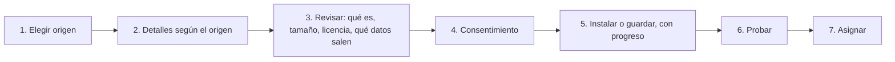
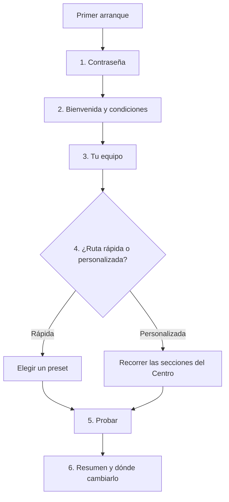
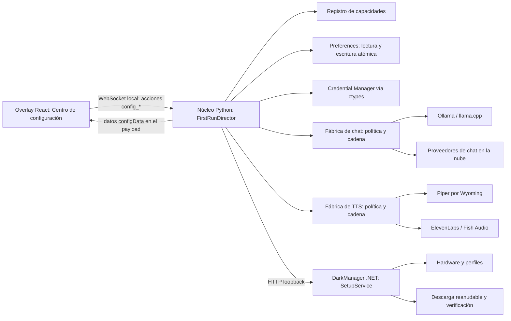

# Diseño del primer arranque y del centro de configuración de D.A.R.K.

**Versión:** 3 (23 de noviembre de 2026). La v2 incorporó la documentación de `docs/installer` y `docs/arquitectura_paquetes_y_proveedores.md`; la v3 reorganiza los menús en **bibliotecas de recursos con un flujo «Agregar»** (modelos de pensamiento, voces, modelos de reconocimiento de voz y personas con datos biométricos).
**Estado:** diseño con las decisiones D1, D2, D4, D5, D11, D12 y D13 ya tomadas por el titular (§19). No hay nada implementado de este documento.

**Documentación en la que se apoya** (y que la v1 de este diseño no aprovechó lo suficiente):

| Documento | Qué aporta a este diseño |
|---|---|
| [M0_1_CONFIGURACION](M0_1/M0_1_CONFIGURACION.md) | Contrato de archivos: `preferences.json` (sin secretos, con referencias opacas a credenciales), Credential Manager para claves, precedencia de configuración, tabla de puertos |
| [M0_1_DISTRIBUCION](M0_1/M0_1_DISTRIBUCION.md) §E y §F | Tabla de situaciones de Ollama; reglas de voz: «FirstRun debe probar salida», qué hace falta para voz a voz |
| [M0_1_COMPONENTES](M0_1/M0_1_COMPONENTES.md) y [M0_1_ARRANQUE](M0_1/M0_1_ARRANQUE.md) | `FirstRunDirector` como componente que aún no existe; orden de arranque (FirstRun al final); política de modelos |
| [M5_3 Piper y voces](M5_3_REVISION_PIPER_Y_VOCES.md) | «Recomendación para el selector de primer arranque»: voces Davefx, Sharvard (con hablante) y Carlfm; cambiar y borrar voces desde ajustes |
| [PENDIENTES](PENDIENTES_INSTALADOR_Y_PRIMER_ARRANQUE.md) §5 | Tres caminos de IA, Groq y Gemini recomendados, proveedores propios, TTS por API (Fish Audio, ElevenLabs) con clave en Credential Manager |
| [arquitectura_paquetes_y_proveedores](../arquitectura_paquetes_y_proveedores.md) | Puertos `ChatProvider`, `PuertoTTS`, `PuertoSTT`; fábricas; `DARK_LLM_PROVIDER`, `DARK_TTS_PROVIDER`, `DARK_STT_LOCAL_PROVIDER`; cómo añadir un proveedor |

---

## 1. Qué es el primer arranque (y qué no)

La v1 de este diseño trataba el primer arranque como «hacer que D.A.R.K. funcione». Es más que eso: es el momento en que la persona **amplía lo que D.A.R.K. puede hacer** eligiendo sus motores, y debe poder volver a cambiarlos cuando quiera.

Por eso el diseño tiene dos piezas que comparten todo el código:

1. **El Centro de configuración**: un panel con un menú por sección (Inteligencia, Voz de salida, Voz de entrada, Cámara, Memoria, Privacidad, Claves, Sistema). Es donde vive cada decisión.
2. **El primer arranque guiado**: un recorrido que lleva a la persona por las secciones esenciales del Centro, con una **ruta rápida** (presets) y una **ruta personalizada** (los menús completos).

Lo que se vio en la prueba (D.A.R.K. mudo, sin ninguna explicación; respondió porque usó el Ollama de otro usuario por `localhost`; contraseña ya creada de una prueba anterior) se resuelve con el **registro de capacidades** (§4) y con la regla «una función ausente se muestra como ausente y con su arreglo, nunca como silencio».

## 2. Objetivos y no objetivos

**Objetivos**
1. Elegir cómo piensa D.A.R.K.: **solo modelos locales, solo proveedor en la nube (API), o ambos con una prioridad que elige la persona** (local primero o nube primero).
2. Elegir cómo habla D.A.R.K.: voz local, **voz por API (ElevenLabs, Fish Audio, otras)**, voz básica del sistema o solo texto; también con prioridad si hay más de una.
3. Un **menú por sección** para cambiar cualquier decisión después, y **una biblioteca por tipo de recurso** (modelos de pensamiento, voces, modelos de reconocimiento, personas registradas) donde se puede **agregar, probar, asignar y eliminar** recursos, no solo elegir entre una lista fija.
4. Funcionar **sin ningún modelo, sin API y sin voz** (texto y reglas) y poder completarlo después.
5. Consentimiento explícito antes de cada descarga o envío de datos a terceros.
6. Que añadir un proveedor nuevo sea **añadir una ficha y un adaptador**, no reescribir la interfaz.

**No objetivos**
- No descargar modelos desde el instalador principal (decisión fijada).
- No usar un LLM para guiar la configuración: la guía es determinista.
- No bloquear el uso: salvo la contraseña, todo paso se puede omitir.
- Sin telemetría propia, sin cuentas de D.A.R.K., sin abrir firewall.

## 3. Principios

1. **Honestidad sobre las capacidades.** Cada capacidad muestra su estado real y cómo arreglarla.
2. **Local primero por defecto; nube solo con consentimiento y con indicación visible.**
3. **El usuario manda la prioridad.** El orden entre local y nube es una elección suya, no una decisión interna.
3b. **D.A.R.K. se siente como uno solo.** Una vez que la persona configuró algo, D.A.R.K. lo usa con fluidez: sin interrupciones, sin preguntar en cada turno y sin recordarle a cada respuesta qué motor la generó. La confianza se da **una vez, al configurar**, con un aviso claro (decisión D11).
4. **Reversible y reanudable.** Cerrar en medio no pierde nada; todo se puede cambiar o borrar.
5. **Sin secretos en archivos, argumentos, variables de entorno ni logs.** Claves en Credential Manager; los archivos guardan solo referencias opacas.
6. **Sin sorpresas de coste ni tamaño.** Antes de descargar o de usar un servicio de pago se muestra qué, cuánto y a quién.
7. **No tocar lo ajeno.** Un Ollama existente (propio o de otro usuario) no se modifica ni se detiene.
8. **Un proveedor es una ficha.** Cada proveedor declara qué ofrece, qué datos recibe, cómo se autentica y qué términos aplican; la interfaz se construye a partir de esas fichas.

## 4. Modelo conceptual

### 4.1 Registro de capacidades

Una lista que el programa **calcula con comprobaciones reales** en cada arranque (¿se importa el módulo?, ¿responde el puerto?, ¿hay micrófono?), no con banderas guardadas.

| Capacidad | Qué es | Estados |
|---|---|---|
| `texto` | Interfaz de texto y órdenes por reglas | siempre disponible |
| `ia_chat` | Respuestas conversacionales | `local`, `nube`, `hibrido`, `sin_configurar`, `error` |
| `voz_salida` | Síntesis de voz | `local`, `nube`, `sistema`, `hibrido`, `no_instalada`, `desactivada`, `error` |
| `voz_entrada` | Reconocimiento de voz | `disponible`, `no_instalada`, `desactivada`, `sin_microfono`, `error` |
| `vision` | Registro facial y gestos | `disponible`, `no_instalada`, `sin_camara`, `sin_consentimiento`, `error` |
| `memoria` | Memoria a largo plazo | `activa`, `desactivada`, `sin_clave`, `error` |
| `busqueda_web` | Búsquedas (DuckDuckGo/Bing) | `activa`, `desactivada` |
| `multimedia` | Reproducción multimedia (VLC) | `disponible`, `no_instalada` |

Cada entrada lleva `motivo` legible, `accionDeArreglo` (a qué sección y paso del Centro lleva) y `datosQueSalen` (qué sale del equipo). Una **insignia permanente** en el overlay muestra lo pendiente («IA sin configurar», «Voz no instalada»); un clic abre la sección correspondiente.

### 4.2 Cadena de proveedores por capacidad

El concepto nuevo y central. Cada capacidad con varios motores posibles (`ia_chat`, `voz_salida`, más adelante `voz_entrada`) tiene una **cadena ordenada de proveedores** y una **política**:

| Política | Significado | Cuándo se usa el otro lado |
|---|---|---|
| `solo_local` | Solo motores locales | Nunca |
| `solo_nube` | Solo proveedores en la nube | Nunca |
| `local_primero` | Local, con la nube de respaldo | Si el local no está disponible, falla o supera el tiempo configurado |
| `nube_primero` | Nube, con el local de respaldo | Si la nube falla, no hay red, se agota la cuota o supera el tiempo |

Dentro del lado nube puede haber **varios proveedores ordenados** (por ejemplo Groq y luego Gemini); el orden lo elige la persona arrastrando o con flechas. Hoy `DARK_LLM_PROVIDER=conmutado` ya implementa «nube primero con local de respaldo» de forma fija; el diseño la generaliza a las cuatro políticas.

**Regla de privacidad del respaldo (decisión D11).** Si la política es `local_primero` y el local falla, D.A.R.K. usa la nube **de forma automática y sin preguntar**: la persona añadió esa API porque confía en ella y la experiencia no debe interrumpirse. Para que eso sea honesto y legalmente sólido, la confianza se da **una sola vez, en el momento de configurar**:
1. Al **agregar un proveedor de nube**, y de nuevo al **activar una política híbrida**, se muestra un aviso explícito: «D.A.R.K. podrá enviar lo que escribas a *proveedor* y usarlo automáticamente, también cuando el modelo local falle o tarde. Aplican sus términos y tarifas». Hay que aceptarlo.
2. **No hay preguntas por turno** ni avisos en cada respuesta.
3. Quien quiera más control tiene dos interruptores **apagados por defecto**: «preguntarme antes de usar la nube como respaldo» y «mostrar qué motor respondió» (un icono discreto). También se puede consultar qué motor respondió en la sección Inteligencia, en el botón Probar y en el registro de diagnóstico.
4. La tabla «qué sale de tu equipo» de Privacidad refleja siempre el estado real, incluido el respaldo a la nube.

## 5. El Centro de configuración: menús por sección y bibliotecas de recursos

Panel del mismo estilo visual que los demás (una tarjeta central con la lista de secciones a la izquierda), accesible con la frase «configuración», con el indicador de capacidades y con el primer arranque. Cada sección muestra **estado**, **opciones**, **probar** y **qué sale del equipo**.

### 5.0 Mapa de menús

```
Centro de configuración
├─ Inteligencia
│  ├─ Modo y prioridad
│  ├─ Modelos de pensamiento ......... BIBLIOTECA  (+ Agregar)
│  ├─ Asignación por función (chat · núcleo · código)
│  ├─ Cuentas de nube ................ lista       (+ Agregar proveedor)
│  └─ Probar
├─ Voz de salida
│  ├─ Motor y prioridad
│  ├─ Voces .......................... BIBLIOTECA  (+ Agregar)
│  └─ Ajustes y Probar
├─ Voz de entrada
│  ├─ Micrófono
│  ├─ Modelos de reconocimiento ...... BIBLIOTECA  (+ Agregar)
│  ├─ Palabra de activación .......... ajuste (activar · sensibilidad · probar)
│  └─ Probar
├─ Cámara y biometría
│  ├─ Personas registradas ........... BIBLIOTECA  (+ Agregar persona)
│  ├─ Reglas de acceso por rostro
│  └─ Gestos
├─ Memoria
├─ Privacidad y datos
├─ Claves
└─ Sistema
```

### 5.1 El patrón común: una biblioteca por tipo de recurso

Cuatro secciones comparten **la misma pantalla y el mismo flujo**, así que se construye una vez (un componente de biblioteca) y cada tipo solo aporta su catálogo, sus validaciones y su prueba.

**La lista.** Cada recurso es una fila con: nombre, **origen** (catálogo recomendado · proveedor en la nube · etiqueta propia · archivo propio), tamaño, licencia, huella, **estado** (instalado, descargando, falta, error) y **dónde se usa**.

**Acciones por recurso:** Ver detalle · **Probar** · **Asignar** (a una función o como predeterminado) · **Eliminar** (sin borrar las preferencias ni los demás recursos).

**El flujo «Agregar»**, igual para todos los tipos:



Reglas del flujo:
- **No ocurre nada sin la confirmación del paso 4.** Descargas, envíos a un tercero y capturas biométricas piden consentimiento explícito.
- **Integridad:** se verifica la huella antes de activar; un archivo propio se valida por formato y se rechaza si no cuadra.
- **Sin sobrescritura silenciosa:** si ya existe un recurso con ese identificador y otra huella, se pregunta.
- **Licencias a la vista** antes de instalar (paso 3), y atribuciones guardadas junto al recurso (ver M5_3).
- Cualquier paso se puede **cancelar**; lo parcial se limpia o se reanuda.
- El paso 7 es opcional: un recurso puede quedar instalado sin asignar.

### 5.2 Inteligencia (el cerebro)

**Modo y prioridad:** Solo local · Solo nube · Híbrido con prioridad (local primero o nube primero) · Sin IA (§4.2). Tiempo máximo antes de caer al respaldo (por defecto el `DARK_API_TTFT_TOPE_SEGUNDOS` existente, 8 s) y los dos interruptores opcionales apagados por defecto de §4.2.

**Biblioteca de modelos de pensamiento.** Los orígenes del paso 1 de «Agregar»:

| Origen | Qué se pide | Qué ocurre |
|---|---|---|
| **Catálogo recomendado** | Nada: se ofrecen los modelos del perfil de hardware (`limited`, `standard`, `high`, `station`) con tamaño, RAM, licencia y huella | Descarga reanudable por Ollama y verificación de huella |
| **Etiqueta propia de Ollama** | La etiqueta (por ejemplo `modelo:variante`) | Confirmación aparte; se descarga y se comprueba **después** que quedó instalada |
| **Archivo propio (GGUF)** | La ruta a un archivo `.gguf` para llama.cpp | Se valida el formato, se muestra tamaño y RAM estimada, se **registra sin copiar** por defecto |
| **Nube** | Cuenta de proveedor (existente o nueva) e **identificador del modelo** | Se guarda la referencia; se prueba contra el proveedor |

El motor local puede ser **Ollama** (recomendado) o **llama.cpp** (avanzado, ya soportado). El estado de Ollama sigue la tabla de §8. Cada modelo local muestra su tamaño en disco, RAM estimada y opción de desinstalar.

**Asignación por función.** D.A.R.K. usa modelos distintos para distintas funciones: **chat** (conversación), **núcleo** (interpretación de órdenes) y **código**. Para **cada función** se elige una **cadena ordenada** que puede **mezclar** modelos locales y de nube, con su política (§4.2). Ejemplo: chat → «nube primero» con un modelo grande de Groq y un modelo local de respaldo; núcleo → solo local.
- La biblioteca avisa de **requisitos de la función** (el núcleo necesita salidas estructuradas fiables; un modelo muy pequeño puede no servir) y ofrece **«Probar para esta función»** con una comprobación propia de cada una.

**Cuentas de nube.** Lista de proveedores con su clave (§9). Una cuenta puede ofrecer modelos de pensamiento, voces o ambos; la biblioteca correspondiente la usa. Catálogo: **Groq** y **Gemini** (recomendados), **OpenRouter** y **«Otro compatible con OpenAI»** (nombre, dirección base, modelo).

### 5.3 Voz de salida (cómo habla)

**Motor y prioridad:** Local (Piper por Wyoming) · Nube (**ElevenLabs**, **Fish Audio**, otras) · Voz del sistema (Windows, básica) · Ninguna. Mismas políticas que §4.2.

**Biblioteca de voces.** Orígenes de «Agregar»:

| Origen | Qué se pide | Notas |
|---|---|---|
| **Catálogo local** | Elegir una de las voces revisadas: **Davefx medium** (recomendada), **Sharvard medium** (con elección de **hablante 0 o 1**), **Carlfm x_low** | Créditos y licencias a la vista; se guardan juntos el modelo, su `.onnx.json`, el `MODEL_CARD` y el origen (M5_3) |
| **Voz de nube** | Cuenta del proveedor y la voz: se **listan las voces de la cuenta** o se agrega por identificador | Se oye una vista previa antes de asignar |
| **Voz del sistema** | Elegir entre las voces que Windows tiene instaladas (idioma indicado) | Calidad básica; se avisa |
| **Archivo propio** (más adelante) | Modelo y `.onnx.json` de Piper más su `MODEL_CARD` | Exige leer y aceptar la licencia y la cadena de datos; ver §12 |

- **Vista previa** de cada voz antes de asignar; **«Probar»** reproduce una frase y es **obligatorio para marcar «voz lista»**.
- **Asignación:** voz principal y voz de respaldo, según la política del motor.
- **Aviso de consumo (D13)** al agregar una cuenta de voz de pago: «Las voces por API cobran según el consumo. Cuida tu uso desde la cuenta del proveedor; D.A.R.K. no limita ni mide ese gasto». Hay que aceptarlo para guardar la clave.
- **Voces clonadas o personalizadas quedan fuera de esta versión** (D14): «Agregar voz» significa elegir o importar una voz existente, no crear una nueva a partir de grabaciones.
- `edge_tts` no se activa por defecto: si se conserva, es una cuenta de nube más con su aviso.

### 5.4 Voz de entrada (cómo escucha)

- **Micrófono:** selección y medidor de nivel.
- **Biblioteca de modelos de reconocimiento** (Whisper): se agrega un tamaño del catálogo con su descarga, RAM y precisión esperada, o un archivo `ggml` para whisper.cpp. Motor: **faster-whisper** (por defecto) o **whisper.cpp**.
- **Palabra de activación:** es la palabra que despierta a D.A.R.K. por voz (decir «Dark»). Hoy existe **un solo modelo** (`dark.onnx`, entrenado con openWakeWord) y no se pueden crear palabras nuevas sin entrenarlas, así que **no es una biblioteca sino un ajuste**: activar o desactivar la activación por voz, **sensibilidad** (hoy un umbral de 0,8) y una **prueba** (decir la palabra y ver si responde). Si algún día hubiera más modelos, se promovería a biblioteca con el mismo componente.
- **Estado (24 nov 2026, v24):** el paquete de voz **ya viaja** en la instalación (PyAudio, openWakeWord con `dark.onnx`, faster-whisper sin modelos). El reconocimiento **arranca con el reconocedor de Windows**; Whisper es opcional y se habilita desde esta sección eligiendo un tamaño (tiny, base, small, medium): la descarga empieza entonces, con consentimiento, y se puede volver a Windows o borrar el modelo. Los cambios se aplican al reabrir D.A.R.K. Aún falta: elegir micrófono con medidor de nivel y «probar» la palabra de activación.

### 5.5 Cámara y biometría

**Biblioteca de personas registradas.** Cada fila es una persona con nombre, fecha, número de muestras, calidad y si su acceso está activo. **No se guardan fotos**: solo el vector numérico, cifrado con DPAPI en el equipo.

| Acción | Detalle |
|---|---|
| **Agregar persona** | Consentimiento **de la persona que se registra** (si no es quien usa el equipo, debe estar presente y aceptar ella misma). Captura guiada con indicaciones de ángulo y luz, número mínimo de muestras buenas y resultado de calidad |
| **Volver a capturar** | Mejora un registro existente sin perder el anterior hasta confirmar |
| **Activar o desactivar acceso** | Sin borrar los datos |
| **Eliminar persona** | Borra su vector; **«Eliminar todo»** vacía la biblioteca y el modelo descargado |

**Reglas de acceso por rostro:** sensibilidad (umbral), tiempo de ausencia antes de volver a bloquear (hoy `AUSENCIA_SEG`) y qué ocurre si no se reconoce a nadie (la contraseña sigue abriendo). **Gestos:** calibración de manos. Requieren el **paquete de visión**, no incluido (D5): el menú está diseñado y se muestra como «no incluido en esta versión». El panel de registro facial actual, de una sola persona, **evoluciona** a esta biblioteca.

### 5.6 Memoria

Interruptor (**encendida por defecto**, D2), «Ver y borrar mis recuerdos», copia de recuperación de la clave (ya existe) y una frase llana de qué se guarda. Extraer recuerdos necesita un modelo; sin IA configurada no hay nada que recordar.

### 5.7 Privacidad y datos

Qué se guarda y dónde, búsqueda web (activa o desactivada), una **tabla viva de qué sale de tu equipo según tu configuración actual** (incluido el respaldo a la nube), exportar diagnóstico redactado y **«Restablecer D.A.R.K.»** (borra datos, credenciales y contraseña, D1).

### 5.8 Claves

Todas las claves guardadas (proveedor, fecha, **sin mostrar el valor**), reemplazar, borrar y **migrar** desde `config/online_coder.json` o `DARK_CHAT_API_KEY` (importación con consentimiento). Es el único lugar donde se tocan secretos.

### 5.9 Sistema

Inicio automático (opt-in), ubicación de modelos y datos con comprobación de espacio, estado de servicios (puertos, salud), reparar, versión, condiciones y avisos de terceros.

## 6. Primer arranque: recorrido guiado



**Presets de la ruta rápida** (cada uno fija varias secciones a la vez y se puede refinar después):

| Preset | Inteligencia | Voz de salida |
|---|---|---|
| **Todo en mi equipo** | Solo local (Ollama + perfil recomendado) | Local, o texto si no hay paquete |
| **Todo en la nube** | Solo nube (proveedor elegido) | Nube (proveedor de voz elegido) |
| **Híbrido: local primero** | Local con nube de respaldo | Local con nube de respaldo |
| **Híbrido: nube primero** | Nube con local de respaldo | Nube con local de respaldo |
| **Solo texto por ahora** | Sin IA | Ninguna |

La ruta personalizada abre el Centro y la guía visita Inteligencia, Voz de salida, Voz de entrada, Cámara y biometría, Memoria y Privacidad, en ese orden. En cada sección con biblioteca ofrece **«Agregar»** ahora o «Más tarde», y siempre hay «Omitir» y «Atrás».

**Pasos fijos:**
1. **Contraseña.** Se mantiene la pantalla existente, explicando qué protege, pidiendo confirmación y diciendo que es **por usuario de Windows y sin recuperación**: si se olvida, «Restablecer» borra los datos locales (D1).
2. **Bienvenida y condiciones.** Versión, canal, y las condiciones aceptadas en el instalador (versión y huella); si la versión cambió, se vuelven a aceptar.
3. **Tu equipo.** RAM, VRAM, espacio libre y perfil recomendado, con la frase «es una recomendación, no una garantía».
4. **Prueba y cierre.** Una comprobación por capacidad configurada y un resumen. «Prueba lista» exige haber **probado la salida de voz** si se eligió una (regla ya documentada).

## 7. Proveedores: la ficha

Cada proveedor (de chat, de voz o futuro de reconocimiento) se describe con una ficha de datos; la interfaz la lee para pintar su formulario y su aviso, y el adaptador implementa el puerto correspondiente.

```json
{
  "id": "elevenlabs",
  "tipo": "tts",
  "nombre": "ElevenLabs",
  "autenticacion": { "metodo": "api_key", "etiqueta": "Clave de API" },
  "datosQueRecibe": ["texto a sintetizar"],
  "datosQueDevuelve": ["audio"],
  "terminos": { "uri": "…", "revisadoEl": "…", "usoComercialPermitido": "verificar" },
  "formatosAudio": ["pcm", "mp3"],
  "streaming": true,
  "listaDeVoces": { "origen": "api" },
  "cuotaConsultable": "verificar",
  "regionesYRetencion": "verificar"
}
```

**Ficha obligatoria antes de habilitar un proveedor.** Cada proveedor de nube exige revisar y registrar: términos de uso y uso comercial, política de retención de datos, condiciones sobre voces personalizadas o clonadas, restricciones de contenido, límites de tasa, formatos de audio y latencia, precios y plan gratuito, y región de procesamiento. **No se asume nada de ElevenLabs ni de Fish Audio sin comprobarlo en su documentación vigente** en el momento de implementar (hay una tarea de investigación en §17).

### 7.1 Adaptadores de voz por API

Cumplen `PuertoTTS` (`contratos/voz.py`) y se registran en `voz/fabrica_tts.py`, el único sitio que nombra motores; las pruebas AST de `tests/test_adaptadores_voz.py` vigilan el aislamiento. Detalles del contrato que hay que respetar: `nivel_salida` (RMS de lo que suena) es obligatorio y los adaptadores sin PCM medible devuelven `0.0`; si un proveedor pedido de forma explícita no está disponible, la fábrica lanza `ImportError` y el Núcleo arranca mudo con el motivo impreso.

Un **TTS conmutado** (análogo al `conmutado` del chat) compone local y nube según la política.

**Salida de audio sin dependencias nuevas.** El payload no trae `pyaudio` ni VLC, y hoy el audio sale por ahí. Para que una voz por API suene sin añadir paquetes, el diseño propone una **salida nativa de Windows**: `winsound` (biblioteca estándar) para audio WAV/PCM en memoria, y la API `winmm` (MCI) vía `ctypes` para MP3. Pedir al proveedor formatos PCM/WAV cuando los ofrezca evita decodificar. **Requiere prototipo y medición de latencia** antes de comprometerse (tarea en §17).

**Caché y coste.** Las frases repetidas (confirmaciones, avisos cortos) se cachean por voz para no pagar ni esperar dos veces; es el mismo propósito de la caché de rellenos actual.

## 8. Ollama y modelos locales: situaciones

Tabla de M0_1_DISTRIBUCION §E, aplicada al flujo:

| Situación | Resultado |
|---|---|
| Sin Ollama | Se **ofrece instalar la versión oficial fijada** con consentimiento (D4): origen, tamaño (≈1,7 GB), huella SHA-256. No se marca «listo» hasta que la API responda |
| Ollama existente y compatible (incluido el de otro usuario) | Se reutiliza **intacto**; se informa y se listan sus modelos |
| Ollama instalado pero detenido | Se ofrece iniciarlo; nunca se mata uno ajeno |
| Ollama incompatible o en otro puerto | Configuración separada tras una decisión explícita; campo avanzado de dirección validado |
| Modelo ausente | Confirmar licencia y espacio; descarga con progreso, huella y reanudación |
| Modelo disponible | Se verifica por la API y se reutiliza si coincide |
| Etiqueta existente con otra huella | No se sobrescribe sin preguntar |
| Descarga interrumpida | Diario `Interrupted`; reanudar y validar; no se marca instalada |
| Espacio insuficiente | Se detiene **antes** de descargar; ofrece cambiar de selección o de ubicación |
| Puerto de un tercero | No se cierra el proceso |

**Selección.** Perfil recomendado por hardware con tres modelos (`chat`, `nucleus`, `coder`): descargas indicativas de `limited` ≈ 1,3 GB, `standard` ≈ 13,7 GB, `high` ≈ 27 GB. La persona acepta, cambia un modelo, **no instala alguno** (por ejemplo sin `coder`) o escribe una etiqueta propia (confirmación aparte y comprobación posterior de que quedó instalada). El perfil `limited` usa modelos de 0,5 a 0,6 B parámetros y el texto debe decir que las respuestas serán básicas.

**Residencia en memoria** (M0_1_ARRANQUE): no se precargan modelos; uno conversacional residente; DarkManager sigue siendo el único árbitro de memoria. El asistente **no crea una segunda política**.

## 9. Claves y secretos

- Las claves viven en el **Administrador de credenciales de Windows**, destino `D.A.R.K/api/<proveedor>`, escritas con `CredWrite` vía `ctypes` (sin `pywin32`, igual que el DPAPI del registro facial).
- `preferences.json` guarda solo **referencias opacas** (`credentialRef`), nunca el valor.
- El campo de clave es enmascarado; el valor se envía **una sola vez** del overlay al Núcleo por el puente local, se guarda y no se vuelve a mostrar, registrar ni transmitir. Los logs redactan `api_key` y `Authorization`.
- **Prueba de conexión explícita**: botón que hace una petición mínima y dice qué envía.
- **Migración consentida** de `config/online_coder.json` y `DARK_CHAT_API_KEY` (M0_1_CONFIGURACION): se importa, se verifica y solo entonces se ofrece borrar el origen.
- Cambio de código necesario: `proveedores/llm/remoto.py` lee hoy la clave en **texto plano** de `config/online_coder.json`, ruta relativa a la carpeta de la app (se borra al actualizar y no viaja en el instalador). Pasa a leer de Credential Manager y de `%LOCALAPPDATA%\DARK\config`.

## 10. Estado y persistencia

Se respeta el contrato de M0_1_CONFIGURACION:

| Archivo | Contenido | Dueño |
|---|---|---|
| `%LOCALAPPDATA%\DARK\config\preferences.json` | Las **elecciones** de cada sección y referencias a credenciales. Sin secretos | Usuario / FirstRun |
| `%LOCALAPPDATA%\DARK\config\firstrun.json` | Progreso del recorrido y condiciones aceptadas | FirstRunDirector |
| Credential Manager | Claves | Windows, por usuario |
| `runtime.json` | Endpoints y puertos (lo escribe el Supervisor) | Instalador/Supervisor |

Las **bibliotecas** guardan solo metadatos y referencias; los vectores biométricos viven en su archivo cifrado con DPAPI, **nunca** en `preferences.json`. Las **asignaciones** apuntan a recursos de las bibliotecas por su `id`, de modo que borrar un recurso obliga a reasignar la función que lo usaba (la interfaz lo avisa antes).

Precedencia (M0_1_CONFIGURACION): **valores del producto < `runtime.json` < `preferences.json` < variables de entorno autorizadas < parámetros temporales**. Los valores inválidos se muestran, no se sustituyen en silencio.

```json
{
  "schemaVersion": 1,
  "bibliotecas": {
    "modelosPensamiento": [
      { "id": "ollama:qwen3-4b-q8", "origen": "catalogo", "motor": "ollama",
        "tag": "…", "digest": "sha256:…", "estado": "instalado" },
      { "id": "groq:llama-70b", "origen": "nube", "cuenta": "groq", "modelo": "…" },
      { "id": "gguf:mi-modelo", "origen": "archivo", "motor": "llamacpp", "ruta": "…", "huella": "sha256:…" }
    ],
    "voces": [
      { "id": "piper:es_ES-davefx-medium", "origen": "catalogo", "motor": "piper", "hablante": 0, "licencia": "CC0" },
      { "id": "elevenlabs:…", "origen": "nube", "cuenta": "elevenlabs", "vozId": "…", "avisoConsumoAceptado": true },
      { "id": "sistema:es-ES", "origen": "sistema", "voz": "…" }
    ],
    "modelosReconocimiento": [],
    "personas": [ { "id": "p1", "nombre": "…", "creadaUtc": "…", "muestras": 12, "accesoActivo": true } ]
  },
  "cuentasNube": [
    { "id": "groq", "tipo": "chat", "credentialRef": "D.A.R.K/api/groq" },
    { "id": "elevenlabs", "tipo": "voz", "credentialRef": "D.A.R.K/api/elevenlabs" }
  ],
  "asignaciones": {
    "pensamiento": {
      "chat":   { "politica": "nube_primero", "cadena": ["groq:llama-70b", "ollama:qwen3-4b-q8"] },
      "nucleo": { "politica": "solo_local",   "cadena": ["ollama:qwen2.5-7b"] },
      "codigo": { "politica": "solo_local",   "cadena": [] }
    },
    "vozSalida": { "politica": "nube_primero", "cadena": ["elevenlabs:…", "piper:es_ES-davefx-medium"] },
    "vozEntrada": { "modelo": null }
  },
  "ajustes": {
    "tiempoMaximoLocalSeg": 8,
    "preguntarAntesDeNube": false,
    "mostrarMotorQueRespondio": false,
    "avisoNubeAceptado": { "version": "1", "atUtc": "…" },
    "memoriaActiva": true,
    "busquedaWeb": true,
    "accesoFacialActivo": false,
    "palabraActivacion": { "activa": true, "sensibilidad": 0.8 }
  }
}
```

`firstrun.json` guarda `wizardVersion`, el estado de cada paso (`pending`, `done`, `skipped`, `failed`) y la aceptación de condiciones (versión, huella, fecha). Es idempotente y reanudable; si sube `wizardVersion` solo se preguntan los pasos nuevos.

## 11. Arquitectura y contratos



- **FirstRunDirector** (nombre de M0_1_COMPONENTES) vive en el Núcleo, orquesta el recorrido y expone el Centro. Se inicia al final del orden de arranque (M0_1_ARRANQUE), después de que el overlay y la UI respondan.
- **Patrón ya probado:** la UI recibe estado en el *payload* (`configData`) y envía acciones por el puente local, igual que «Mis sitios» y «Registro facial».
- **Trabajo pesado en .NET:** hardware, perfiles y descargas reanudables ya existen y están probados en `DarkSetup`. Se extrae a una biblioteca y la hospeda DarkManager, que ya corre bajo el Supervisor en loopback. Alternativa descartada: reescribirlo en Python (duplica lógica y necesita `psutil`, ausente del payload).
- **Un único componente de biblioteca** en el Núcleo y en la interfaz, parametrizado por tipo de recurso. Cada tipo aporta un **adaptador de catálogo** (qué orígenes ofrece), un **validador** (qué comprueba antes de aceptar), una **prueba** y la forma de **instalarlo**. Añadir un tipo nuevo de recurso es añadir un adaptador, no una pantalla.
- **Acciones de la UI** (solo origen local, sesión desbloqueada salvo la contraseña): `config_open`, `config_set`, `config_test`, `config_library_list`, `config_library_add` (con origen, datos y `aceptado: true`), `config_library_remove`, `config_assign` (recurso a función o a cadena), `config_order` (reordenar), `config_key_save`, `config_key_delete`, `config_person_capture` (con el consentimiento de la persona), `config_voice_preview`, `config_cancel`, `config_reset` (con confirmación). Toda acción que descarga, envía datos o captura datos biométricos exige consentimiento explícito, como `facial` con `aceptado`.

**Cambios previos necesarios en el código existente**

1. `proveedores/llm/fabrica.py`: generalizar `conmutado` en una **cadena ordenada con política** (`solo_local`, `solo_nube`, `local_primero`, `nube_primero`) y varios proveedores de nube.
2. `proveedores/llm/remoto.py`: claves y configuración desde Credential Manager y `%LOCALAPPDATA%\DARK\config`.
3. `voz/fabrica_tts.py`: añadir adaptadores ElevenLabs y Fish Audio y un TTS conmutado; salida de audio nativa.
4. `models.chat` y `models.nucleus` de `runtime.json` pasan a leerse de `preferences.json` (hoy son fijos).
5. Credential Manager por `ctypes`; esto también arregla la clave de la memoria, que hoy usa `win32cred` (ausente del payload).
6. Registro de capacidades como módulo propio, que sustituye a los `try/except ImportError` dispersos.
7. **Memoria encendida por defecto (D2):** hoy `DARK_MEMORIA_ACTIVA` está **apagada** por defecto y M0_1_CONFIGURACION lo documenta así; hay que cambiar el valor y actualizar ese documento.
8. Resolver el **conflicto de puertos** de llama.cpp con el 8080 (M0_1_CONFIGURACION).

## 12. Seguridad y privacidad

- **Origen:** acciones `config_*` solo desde `127.0.0.1`/`::1`, con el puente ya limitado a loopback. Loopback no autentica a otros procesos del mismo usuario: el diseño de IPC del Supervisor (M0.1) sigue pendiente.
- **Claves:** solo Credential Manager; nunca en JSON, argumentos, variables de entorno de hijos ni logs.
- **Descargas:** hosts de una lista fija **fuera** de cualquier manifiesto; huella verificada antes de ejecutar o activar; sin ejecutar instaladores sin confirmación.
- **Nube:** un aviso por proveedor, **una sola vez al agregarlo**, con qué datos salen (texto de la conversación o texto a sintetizar), a quién, bajo qué términos y que D.A.R.K. podrá usarlo automáticamente también como respaldo (§4.2, D11). El consentimiento queda registrado con versión y fecha.
- **Registro de consentimientos:** qué se aceptó, versión de condiciones y fecha, sin datos innecesarios.
- **Voz por API:** el texto que D.A.R.K. dice se envía al proveedor. Los datos personales que aparezcan en una respuesta viajan con él: debe decirse.
- **Sin telemetría propia.**

**Consecuencias legales que hay que cerrar** (sin abogado por ahora; ver plan del canal Tester):
- **Memoria encendida por defecto (D2):** la Parte B de las condiciones y la política deben decirlo, y el aviso visible del Centro hace de autorización informada. Debe revisarla un abogado antes de la venta.
- **Proveedores en la nube:** cada ficha exige revisar términos de uso y uso comercial; no se activa un proveedor sin esa revisión registrada.
- **Respaldo automático a la nube (D11):** como no se pregunta por turno, la **política de privacidad y las condiciones deben describirlo** con claridad, y el aviso de configuración es la autorización informada. Revisión de abogado pendiente.
- **Voces personalizadas o clonadas:** quedan **fuera del alcance** de la primera versión por sus implicaciones de consentimiento y derechos de imagen y voz.
- **Recursos de archivo propio** (modelos GGUF, voces ONNX): la persona es responsable de su licencia. El flujo muestra el `MODEL_CARD` o la licencia, exige aceptarla y no asume que un archivo sea redistribuible.
- **Registrar a otra persona:** la captura biométrica exige el consentimiento **de esa persona**, presente en el momento. El titular del equipo no puede dar ese consentimiento en su nombre.

## 13. Errores y casos límite

| Caso | Comportamiento |
|---|---|
| Ollama de otro usuario en 11434 | Se reutiliza sin tocarlo y se avisa |
| Disco insuficiente | Aviso con cifras antes de descargar; ofrece un perfil menor |
| Sin red o proxy | Mensaje claro; las demás secciones siguen disponibles |
| Descarga cortada | Se reanuda; opción de cancelar y limpiar parciales |
| Clave inválida, sin saldo o 429 | Mensaje específico; se guarda o se descarta a elección |
| Cuota de voz agotada | Cae al respaldo según la política sin interrumpir, o sigue en texto; no se muestra nada por turno salvo que la persona haya activado «mostrar qué motor respondió» |
| Proveedor de nube lento o caído | Respaldo según la política; el tiempo máximo es configurable |
| Ninguna voz funciona | D.A.R.K. sigue en texto y la insignia lo dice; nunca se marca «voz lista» sin prueba |
| Sin micrófono o cámara | La sección se omite sin error |
| Se cierra a mitad | Se reanuda en el paso pendiente |
| Windows Firewall al arrancar Ollama | Se avisa de antemano que es normal |

## 14. Interfaz y accesibilidad

- Una **tarjeta central por sección o paso**, con el estilo visual de D.A.R.K.; lista de secciones a la izquierda en el Centro.
- Cada sección muestra siempre: estado, opciones, «Probar» y «Qué sale de tu equipo».
- Teclado completo, foco visible, etiquetas para lectores de pantalla, contraste suficiente, texto escalable y ningún límite de tiempo.
- Reordenar proveedores con **arrastrar y también con botones** «subir/bajar».
- Progreso global visible; resumen siempre a un clic.
- Español sin jerga: «modelo» se explica como «el cerebro de IA que se instala en tu equipo».

## 15. Pruebas y criterios de aceptación

**Automáticas**
- Políticas de la cadena (`solo_local`, `solo_nube`, `local_primero`, `nube_primero`) con proveedores simulados: caída, lentitud, cuota agotada, sin red.
- Máquina de estados de Ollama con un servidor falso (en ejecución, ausente, detenido, otro puerto, descarga cortada, huella distinta).
- Planificador de perfiles (reutiliza las 63 validaciones de `DarkSetup`) con hardware simulado.
- Credential Manager por `ctypes`: ida y vuelta, borrado, y ausencia de claves en archivos y logs.
- Adaptadores de voz con servidores falsos: formatos, errores, cancelación, `nivel_salida`.
- Acciones `config_*`: rechazo desde origen remoto, sin consentimiento y con sesión bloqueada.
- Pruebas AST que garantizan que solo las fábricas nombran motores.

**Manuales** (equipo limpio): sin Ollama, sin red, disco justo, Ollama ajeno activo; claves válida, inválida y sin saldo; cada preset hasta una conversación y una frase hablada; cierre a mitad de descarga y reapertura.

**Aceptación**
1. Una persona sin conocimientos llega a una conversación (o a un «solo texto» entendido) **sin ayuda**.
2. El orden local/nube que eligió es el que se usa, **sin interrumpir la conversación**, y el uso de la nube como respaldo quedó aceptado de forma explícita al configurarlo.
3. Ninguna descarga ocurre sin consentimiento; ninguna clave sale de Credential Manager.
4. «Voz lista» solo si se probó una frase.
5. Cerrar y reabrir en cualquier punto no pierde ni duplica nada.
6. Un Ollama ajeno queda intacto.

## 16. Plan de implementación por partes

| Parte | Contenido | Depende de | Primera ronda con testers |
|---|---|---|---|
| **P1** | Registro de capacidades e insignia honesta. **Hecho (23 nov 2026):** módulo `dark_python/capacidades/`, insignia y panel «Estado de D.A.R.K.» (frase «estado de capacidades»); 32 pruebas de Python y 6 de JS | — | **Sí** |
| **P2** | `preferences.json` y `firstrun.json`, FirstRunDirector, esqueleto del Centro (mapa de menús, tarjetas, navegación) y **componente de biblioteca genérico** (lista, detalle, flujo «Agregar», asignar, probar, eliminar). **Hecho (23 nov 2026):** módulos `dark_python/centro/`, asistente inicial y Centro con navegación lateral (frase «centro de configuración»), `BibliotecaPanel` genérico verificado en navegador con un adaptador de demostración; 53 pruebas de Python y 40 de JS; payload `privacy-v17` | P1 | **Sí** |
| **P3** | Credential Manager por `ctypes`, sección **Claves**, **cuentas de nube** y migración consentida. **Hecho (24 nov 2026):** `dark_python/credenciales/` (almacén `ctypes`, servicio de claves `D.A.R.K/api/<id>`, migración), sección «Claves» del Centro (agregar/reemplazar/borrar con confirmación, importar con consentimiento, aviso de consumo en voces), `remoto.py` y el rotador leen del almacén y de `%LOCALAPPDATA%\DARK\config\online_coder.json`, la clave de la memoria ya no depende de `pywin32`; 31 pruebas de Python y 6 de JS, y prueba contra el Administrador de credenciales real. Pendiente para P4: elegir proveedor/modelo desde la interfaz (hoy el archivo `online_coder.json` sigue definiendo los modelos) | — | **Sí** |
| **P4** | **Biblioteca de modelos de pensamiento**, orígenes nube y etiqueta propia; **asignación por función con cadena y política**; sección Inteligencia **Hecho (24 nov 2026):** `centro/pensamiento.py` (orígenes nube —con llamada de prueba previa y consentimiento— y modelo ya instalado en Ollama), `proveedores/llm/cadena.py` (cadena por función con las cuatro políticas; `solo_nube` nunca cae al local; se lee en cada llamada, así que un cambio en el Centro vale desde el siguiente turno), funciones chat/núcleo/código conectadas en el Núcleo, y guía de D.A.R.K. por sección; 37 pruebas de Python y 1 de JS. **Pendiente:** descargar modelos de Ollama (P5), interruptores «preguntarme antes de usar la nube» y «mostrar qué motor respondió», tiempo máximo editable en pantalla, y «Probar para esta función» | P2, P3 | **Sí** |
| **P5** | Biblioteca de modelos de pensamiento, orígenes **catálogo y archivo propio**: `SetupService` en DarkManager, Ollama (detectar, ofrecer instalar), perfiles, descarga y verificación **Hecho en parte (24 nov 2026):** orígenes «Catálogo recomendado» (perfil por RAM, tamaño, licencia, huella, espacio comprobado antes, descarga con progreso y cancelación, huella verificada después) y «Etiqueta propia» (confirmación aparte, comprobación posterior) en `centro/ollama_local.py` y `centro/pensamiento.py`; port a Python de las reglas de `OllamaModelInstaller.cs` (solo Ollama local, nunca se sobrescribe una etiqueta con otra huella); `config/model-profiles.json` ya viaja en el payload; 32 pruebas nuevas y verificación de solo lectura contra el Ollama real. **Decisión de implementación:** la descarga va por la API de Ollama desde el Núcleo (no por `SetupService` en DarkManager): Ollama ya gestiona reanudación y capas, y DarkManager sigue siendo el árbitro de memoria. **Pendiente:** instalar Ollama si falta (D4) —necesita un instalador oficial fijado (URL y SHA-256) que aún no está en la configuración y una autorización para descargarlo—, iniciar un Ollama detenido, perfil por VRAM y ubicación de modelos elegible | P2, P4 | **Sí** |
| **P6** | **Salida de audio nativa**, adaptadores **ElevenLabs y Fish Audio**, TTS conmutado y **biblioteca de voces** (nube y sistema, prueba obligatoria) **Hecho en parte (24 nov 2026):** `voz/salida_nativa.py` (reproduce por `winsound` **desde un archivo temporal en modo asíncrono**: se midió que `SND_MEMORY` es síncrono y nada lo corta desde otro hilo, lo que habría roto el barge-in), `voz/proveedores_voz.py` (ElevenLabs con `pcm_24000`, Fish Audio con `wav`, voces de Windows por PowerShell sin interpolar texto), `voz/tts_nube.py` (caché de frases cortas) y `voz/tts_cadena.py` (cadena con las cuatro políticas; «solo nube» nunca cae a lo local; se instala solo mientras haya cadena, así que quien no eligió voz no nota nada), biblioteca «Voces» (nube y sistema; consentimiento y aviso de consumo D13; «voz lista» = generó audio; «Probar» suena de verdad) y la capacidad «Voz de salida» refleja la voz elegida; 54 pruebas, verificación real de winsound (corte medido: 0,31 s de 2 s) y de las voces de Windows. **Ficha de proveedores:** endpoints, cabeceras y formatos verificados en su documentación el 24 nov 2026 (detalle en el docstring de `proveedores_voz.py`); **sin verificar:** si `pcm_24000` de ElevenLabs exige plan de pago, términos de uso, retención y uso comercial de ambos, y el formato de la lista de voces de Fish Audio. **Pendiente:** listar las voces de una cuenta (hoy se pega el identificador), voz local de Piper (P9), probar con una cuenta real, latencia medida de punta a punta | P2, P3 | **Sí** |
| **P7** | Pasos fijos del primer arranque, **presets de la ruta rápida** y prueba final **Hecho en parte (24 nov 2026):** recorrido de cinco pasos (bienvenida, tu equipo, ruta, prueba, resumen; `WIZARD_VERSION` 2: quien ya lo hizo retoma en los pasos nuevos). «Tu equipo» muestra RAM, espacio, perfil recomendado y estado de Ollama (`centro/equipo.py`; la VRAM no se mide y se dice). La ruta rápida ofrece cuatro presets (`centro/presets.py`: local, nube, híbrido local primero, híbrido nube primero) que **usan lo que ya hay en las bibliotecas** —nunca descargan ni agregan nada—, reparten los modelos locales por rol, dicen qué les falta y piden el consentimiento de nube si no se dio antes. La ruta personalizada visita claves, modelos y voces, cada menú con la guía de D.A.R.K. «Prueba» lista lo asignado y **no deja terminar sin haber probado la voz elegida** (se puede omitir el paso). 37 pruebas nuevas con dos mutaciones de control; recorrido verificado en navegador con datos reales de este equipo. **Pendiente:** el preset «Solo texto» (necesita un interruptor de «sin IA» y «sin voz» en el Núcleo), el paso de contraseña dentro del recorrido (hoy es la pantalla de bloqueo de siempre), re-aceptar condiciones si cambió su versión, y los pasos de voz de entrada, cámara y memoria (P8 a P10) | P4 a P6 | **Sí** |
| **P8** | Secciones Memoria, Privacidad, Sistema y «Restablecer» **Hecho en parte (24 nov 2026):** marco de secciones por **bloques** (`centro/secciones.py`: párrafos, tablas, interruptores, listas y acciones con confirmación) que pinta un solo componente. **Memoria** (`centro/memoria.py`): interruptor (D2: encendida por defecto), ver y borrar recuerdos sobre la base cifrada real (probado con SQLCipher del payload), copia de recuperación de la clave; **dice que el Núcleo todavía no usa la memoria en las conversaciones** (etapa 4 pendiente) y la capacidad del Estado ya no promete que «recuerda». **Privacidad y datos** (`centro/privacidad.py`): qué se guarda y dónde, tabla viva de qué sale del equipo, búsqueda web (interruptor real), diagnóstico redactado y **Restablecer** (solo instalación, frase RESTABLECER, borra `config` y `data` sin seguir uniones —probado con una unión real—, credenciales `D.A.R.K/*` y retira la contraseña de Electron al siguiente arranque con `dark_electron/reset.cjs`, que ahora viaja en el payload). **Sistema** (`centro/sistema.py`): solo lectura. 86 pruebas (Python + Node), 8 mutaciones de control. **Sin probar en un Electron real** el retiro de la contraseña. **Pendiente:** inicio automático y ubicación de modelos elegible (necesitan un contrato de instalación), «reparar» | P2 | Sí |
| **P9** | Paquete de voz local: voces de Piper en la biblioteca, **modelos de reconocimiento** y ajuste de **palabra de activación** **Hecho en parte (24 nov 2026):** **Voz de entrada** (`centro/voz_entrada.py`): la palabra de activación como **ajuste real** (encender/apagar y tres sensibilidades; el Núcleo los lee al abrir el micrófono, así que se aplican al reabrir) y estado honesto del paquete de voz («no incluido» si falta cualquiera de sus componentes). **Voz local de Piper** como origen de la biblioteca de voces: solo la que ya está instalada, con su licencia; no se marca «lista» hasta probarla; entra en la cadena de voces como voz de base. 25 pruebas y 7 mutaciones. **No se hizo (y la sección no lo finge):** descargar otras voces de Piper, biblioteca de modelos de reconocimiento (hoy se muestra el modelo configurado), elegir micrófono con medidor y «probar» la palabra de activación: dependen del paquete de voz local, que no está en esta versión ni tiene instalador fijado | P6 | Más adelante (D5) |
| **P10** | Paquete de visión: **biblioteca de personas** (evolución del registro facial) y gestos **Hecho en parte (24 nov 2026):** **Cámara y biometría** (`centro/camara.py`, `acceso/biometria.py`): personas registradas con nombre, fecha, muestras y acceso activo (metadatos cifrados con DPAPI en `personas.bin`), **agregar persona** con el consentimiento de quien se registra y captura en hilo, **activar o desactivar** sin borrar datos (con todas desactivadas la puerta facial no se levanta y la contraseña es la única llave), **eliminar una persona** o **todo** (frase ELIMINAR), y **reglas de acceso** (sensibilidad y tiempo de ausencia) que el Núcleo aplica al crear la puerta. El texto dice la verdad sobre la contraseña: tras un re-bloqueo solo reabre el rostro. 34 pruebas (DPAPI real) y 11 mutaciones. **Sin probar con una cámara real** (no hay en este entorno de pruebas); el registro de una persona nueva requiere el paquete de visión, que no está en esta versión. **No se hizo:** calibración de gestos y «probar» el reconocimiento. El panel de registro facial antiguo se conserva | P2 | Más adelante (D5) |
| **P11** | Orígenes **archivo propio** de voces y avisos de licencia | P6, P9 | Más adelante |

**Mínimo útil para la primera ronda:** P1 a P8. Con eso un tester agrega modelos de pensamiento locales o de nube, los asigna por función con la prioridad que quiera, agrega una voz por API y entiende en todo momento qué le falta. D5 solo excluye los **paquetes locales** de voz y visión; como las bibliotecas de voces de Piper, de reconocimiento y de personas usan el **mismo componente** (P2), cuando lleguen esos paquetes (P9 y P10) solo hay que escribir sus adaptadores, no pantallas nuevas.

## 17. Investigación pendiente antes de implementar

1. **Fichas de ElevenLabs y Fish Audio** (§7): términos y uso comercial, retención, voces propias o clonadas, formatos (PCM/WAV/MP3), streaming, latencia, cuota consultable, precios y plan gratuito, región.
2. **Prototipo de salida de audio nativa** (`winsound` y MCI): latencia hasta el primer sonido, interrupción, formatos que reproduce y medición de `nivel_salida`.
3. **Gemini y Groq como proveedores de chat:** autenticación, endpoint compatible, modelos, límites, y la forma de los errores de cuota.
4. **Políticas de respaldo:** definir con medidas reales los tiempos máximos por defecto (hoy hay 8 s de tope de primer evento del remoto).
5. **Extracción de `DarkSetup.Core`:** qué clases se mueven y cómo se hospedan en DarkManager sin romper el instalador.

## 18. Qué no resuelve este diseño

- La distribución legal y técnica de **voz local y visión** (GPL de Piper, tamaños, alojamiento): depende de D5 y de la revisión legal ya anotada en M5_3.
- El **servidor de licencias y la suscripción**.
- **Actualizaciones** de modelos, voces y del asistente.
- Texto legal definitivo: las pantallas deben alinearse con las condiciones y la política cuando se cierren.

## 19. Decisiones

**Tomadas por el titular (23 de noviembre de 2026)**

| # | Decisión | Resolución |
|---|---|---|
| D1 | Contraseña olvidada | **Sin recuperación; «Restablecer» borra los datos locales**, dicho antes de crearla |
| D2 | Memoria a largo plazo al inicio | **Encendida desde el inicio**; implica salvaguardas (§5.6, §12) y cambiar el valor por defecto actual |
| D4 | Si falta Ollama | **Ofrecer instalarlo con consentimiento**; nunca tocar uno existente |
| D5 | Paquetes locales de voz y visión en la primera ronda | ~~No~~ **Revisada el 24 nov 2026: sí.** El titular autorizó incluir el paquete de visión (rostro) y la voz de entrada (Windows + `dark.onnx`, Whisper opcional) |
| D17 | Tipos de recurso que se agregan desde menús | **Confirmados por el titular**: modelos de pensamiento, voces, modelos de reconocimiento de voz y personas registradas (biometría). La **palabra de activación** es un ajuste simple, no una biblioteca (confirmado por el titular). Un tipo nuevo se añade con un adaptador de biblioteca |
| D11 | Respaldo a la nube cuando el local falla | **Sin preguntar por turno**: «si el usuario agregó su API es porque confía; D.A.R.K. debe sentirse fluido y como uno solo». El permiso se da **una vez al configurar**, con aviso claro; los avisos por turno y «preguntar antes» son opcionales y quedan apagados |
| D12 | Proveedores de voz por API en la primera ronda | **ElevenLabs y Fish Audio, más la voz del sistema de Windows**, tras revisar la ficha de cada proveedor |
| D13 | Control de gasto de voz de pago | **Solo un aviso al agregar la API**: debe cuidar su consumo desde la cuenta del proveedor. Sin contadores ni topes en esta versión |

**Pedidas por el titular en esta revisión (ya incorporadas)**
- Elegir **local, API o ambos con prioridad** → §4.2 y §5.2.
- Voz por **API (ElevenLabs, Fish Audio)** → §5.3, §7.
- **Menús por sección** → §5.

**Pendientes, con mi recomendación**

| # | Decisión | Recomendación |
|---|---|---|
| D14 | Voces personalizadas o clonadas | **Fuera de alcance** de la primera versión |
| D15 | ¿Se permite agregar un **archivo propio** (GGUF para llama.cpp, voz ONNX) en la primera ronda? | **GGUF y etiquetas propias de Ollama sí** (P5); **voces de archivo propio después** (P11), por la revisión de licencia que exigen |
| D16 | ¿Varias personas registradas para el acceso por rostro? | **Sí**, como biblioteca de personas, con el consentimiento de cada una (P10) |
| D3 | Búsqueda web al inicio | Activa y explicada |
| D6 | Proveedores de chat destacados | Groq y Gemini; OpenRouter y «otro» disponibles |
| D7 | Alojamiento de descargas | Solo orígenes oficiales por ahora, con hosts fijados fuera del manifiesto |
| D8 | Dónde corre el hardware y las descargas | DarkManager (.NET) reutilizando `DarkSetup` |
| D9 | `edge_tts` por defecto | No; solo como proveedor de nube explícito |
| D10 | Relanzar el asistente | Sí, como Centro de configuración |
