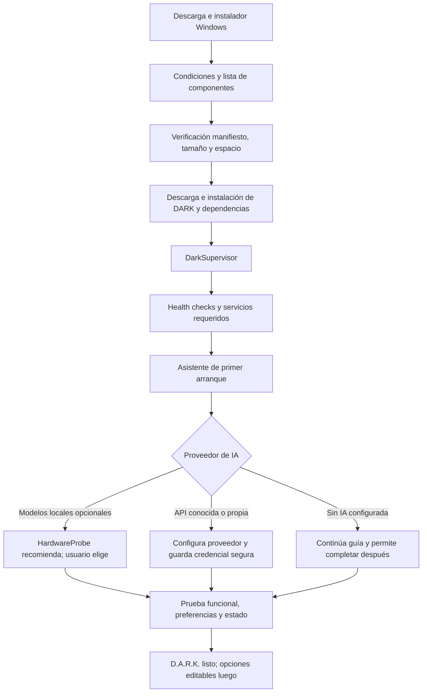

# Traspaso: instalador y primer arranque de D.A.R.K.

**Fecha de corte:** 17 de noviembre de 2026  
**Propósito:** permitir que otro agente continúe el trabajo sin perder las decisiones, el alcance, la evidencia ni los pendientes acordados con el usuario.

## 1. Resumen ejecutivo

D.A.R.K. está pasando de una aplicación de desarrollo que se inicia desde el repositorio a una aplicación Windows instalable, con un Supervisor como autoridad de ejecución y una configuración inicial asistida. La ruta se dividió deliberadamente en fases: primero conocer y estabilizar el producto; luego establecer quién posee los procesos; después crear el instalador del producto y, finalmente, guiar al usuario por su configuración y selección de modelos/proveedores.

La decisión de producto más reciente cambia una premisa anterior: **el instalador principal no descarga modelos de IA**. Descarga/instala los archivos de D.A.R.K. y las dependencias seleccionadas (por ejemplo, Ollama, VLC o Electron cuando correspondan). En el primer arranque, el usuario decide si quiere modelos locales y/o proveedores API. Los modelos locales no son requisito para iniciar DARK.

Hay implementaciones en curso para detección de hardware, recomendaciones por capacidad, manifiestos firmados de modelos, provisión reanudable y una interfaz ejecutable del instalador. Sin embargo, **todavía no existe un instalador de lanzamiento utilizable**: el manifiesto firmado de artefactos de producto, la clave pública de release, el paquete reproducible completo de DARK y las condiciones/licencias finales no están preparados. La publicación Release está intencionalmente bloqueada si falta cualquiera de esos elementos.

## 2. Decisiones de producto que deben conservarse

1. **Orden de producto:** terminar primero el instalador ejecutable que descarga DARK y sus dependencias; después completar la experiencia de primer arranque.
2. **Separación de descargas:** el instalador principal nunca instala ni preselecciona modelos de IA. Los modelos se eligen en primer arranque, con consentimiento y estimación de espacio por modelo.
3. **Modelos opcionales:** no se exige un modelo local. Si el usuario elige local, puede seleccionar un modelo por función —chat, núcleo y código— o usar etiquetas propias de Ollama; una etiqueta propia se muestra y se descarga solo después de confirmación explícita.
4. **Recomendaciones, no imposición:** HardwareProbe y los perfiles de capacidad recomiendan modelos a partir del equipo. El usuario puede aceptar, cambiar o no instalar modelos locales. Las recomendaciones no son garantía de rendimiento ni compatibilidad.
5. **Proveedores API:** recomendar Groq y AIza (Gemini) porque DARK ya los conoce; permitir configurar proveedores propios, incluidos OpenAI, Claude, DeepSeek y otros compatibles con los campos que DARK soporte. Las claves deben guardarse de forma segura, no en JSON de preferencias ni en argumentos de proceso.
6. **Guía asistida:** la guía explica paso a paso cada decisión. La guía no depende de un modelo local ni usa un modelo remoto como requisito para configurarlo; la experiencia inicial debe poder explicar los pasos de forma determinista y accesible.
7. **Autoridad de ejecución:** DarkSupervisor es el futuro punto único de entrada y dueño de los procesos que inicia. No debe terminar procesos que no haya iniciado, en especial instalaciones externas de Ollama.
8. **Compatibilidad:** mantener overrides de entorno y defaults existentes mientras no se migren con validación explícita. No cambiar puertos, rutas o comportamiento de voz incidentalmente. Los tres tiempos de residencia siguen separados (45m Núcleo, 30m DarkManager, 10m planificación); no unificarlos sin una decisión posterior.
9. **Distribución y consentimiento:** antes de instalar, mostrar el contenido descargado, editor/origen, versión, tamaño estimado, tamaño instalado estimado, licencia/enlace y si el componente es obligatorio u opcional. Las condiciones reales deben mostrarse y aceptarse antes de continuar.
10. **Integridad y confianza:** los componentes de release vienen de un manifiesto firmado; cada descarga se valida por SHA-256 antes de considerarse completa. La clave privada de release nunca se guarda en el repositorio ni se comparte en el chat.

## 3. Arquitectura funcional objetivo

### 3.1 Instalador principal

- Aplicación Windows ejecutable, autocontenida para Windows x64 en release (la estrategia final puede ajustarse tras medir el paquete).
- Descarga artefactos de producto/dependencias desde fuentes permitidas descritas en el manifiesto.
- Muestra el detalle de cada selección y el total de descarga/espacio antes del consentimiento.
- Verifica la firma del manifiesto y el SHA-256 de cada archivo.
- Reanuda parciales válidos, muestra progreso y deja estado explícito al cancelar o fallar.
- No instala modelos, no elige proveedor de IA y no presume que Ollama ya existe.
- No toca instancias externas, tiendas de modelos, memorias ni preferencias existentes.
- Las acciones permitidas por artefacto deben ser explícitas y restringidas (solo descarga, extraer ZIP a ruta validada, ejecutar instalador aprobado).

### 3.2 Primer arranque

1. Revisar requisitos de Windows, rutas, espacio y componentes instalados.
2. Explicar que hay tres caminos: modelos locales, proveedor API o completar sin IA configurada.
3. Si escoge modelos locales: revisar Ollama disponible/compatible sin reconfigurarlo si es externo; presentar perfiles recomendados y modelos por función; permitir cambiar modelos o agregar etiqueta propia; mostrar espacio, licencia, digest y confirmación antes de descargar.
4. Si escoge API: presentar Groq y AIza como recomendaciones y un formulario de proveedor propio con nombre, endpoint, modelo y tipo de API compatibles; recoger la clave de forma protegida y guardarla en Credential Manager/almacén seguro de usuario. No registrar claves ni volcarlas en logs.
5. Permitir una configuración parcial; la guía y las pantallas deben funcionar aunque no se haya configurado ninguna IA.
6. Probar el camino escogido, guardar preferencias sin secretos, explicar estado y dejar todas las opciones accesibles en ajustes.

El primer arranque se considera una etapa aparte del instalador. No empezar a fusionarlo con la ventana del instalador hasta cerrar el paquete principal y el contrato de estado instalado.

## 4. Ruta de trabajo por fases

Los hitos M0–M4 son el orden histórico del roadmap. Las fases posteriores son el desglose necesario para completar el producto; no implican que M4 esté cerrado.

| Fase | Objetivo y salida | Estado al corte / cierre requerido |
|---|---|---|
| **M0 — Inventario** | Describir procesos, dependencias, rutas, puertos, modelos, datos y riesgos del repositorio antes de modificar producción. | **Hecho.** Referencia: `M0_INVENTORY.md`. El repositorio tenía trabajo previo sin guardar; conservarlo y no limpiarlo durante el traspaso. |
| **M0.1 — Contratos** | Definir alcance Núcleo v1, contrato de ejecución, configuración, datos, distribución y exclusiones. | **Hecho como diseño**, con temas aún pendientes de decisión. Referencias: `docs/installer/M0_1/`. No confundir propuesta con comportamiento implementado. |
| **M1 — Configuración central** | Crear `config/runtime.json`, esquema y cargador; migrar consumidores conservando defaults/overrides. | **Implementado y validado** en la conversación: configuración ausente/incompleta/incorrecta y precedencia; builds de proyectos migrados. Mantener las limitaciones anotadas en `docs/installer/M1_CONFIGURACION_CENTRAL.md`. |
| **M2 — Frontera del propietario de procesos** | Permitir `local` para desarrollo y `external` cuando un host externo administra procesos; handshake de tokens. | **Implementado y validado manual/automáticamente** según el intercambio. En `external`, Núcleo no inicia, limpia ni termina auxiliares; exige tokens cuando corresponde. Mantener servicios embebidos que quedaron fuera de la frontera. |
| **M3 — Supervisor de sesión** | Supervisor .NET 10 independiente para iniciar, verificar y cerrar procesos propios. | **Prototipo operativo en desarrollo**, manualmente arrancó Managers, voz, UI, Núcleo y Electron; APIs `/status`, `/tasks` y UI respondieron. Todavía usa binarios Debug, `npm run dev` y layout del repositorio; no es el arranque de producción. Se observó anteriormente `ObjectDisposedException` al cerrar y residuos de procesos/puertos; repetir el ciclo varias veces y verificar PID/puertos al terminar antes de cerrar M3. |
| **M4 — Prerrequisitos técnicos del setup** | HardwareProbe, clasificador/perfiles, ProvisioningEngine, manifiestos firmados, modelos recomendados y verificación/reanudación. | **Base técnica implementada; cierre parcial.** `DarkSetup` incluye HardwareProbe, selector de perfiles, planificador, motor reanudable, verificador de manifiesto y descargador de modelos Ollama. Se recibieron/registraron 12 digests de modelos y tamaños máximos de descarga en el trabajo previo. La clave/manifiesto actuales son de desarrollo; falta release. No marcar M4 completo hasta pruebas de hardware real, selección libre/API y límites de paquete. |
| **M5 — Instalador Windows ejecutable** | Entregar downloader ejecutable, transparente, seguro, con condiciones y componentes de DARK/dependencias. | **Interfaz prototipo hecha; release bloqueado.** `DarkInstaller` compila y el ejecutable de desarrollo abre. Lista basada en manifiesto firmado, verifica datos, muestra detalle y soporta acciones acotadas. Hoy falta el manifiesto real, clave pública fijada, paquete completo y condiciones/licencias aprobadas. |
| **M5.1 — Catálogo y cumplimiento de artefactos** | Definir cada descarga principal con versión fijada, fuente HTTPS, hash, tamaño, acción, ruta, licencia, editor y obligatoriedad/opcionalidad; completar SBOM. | **Pendiente y bloqueante para M5.** Investigar versiones actuales en fuentes oficiales y licencias de redistribución. No inventar tamaños/hashes. Distinguir descargar desde proveedor de redistribuir archivos. VLC requiere especial revisión de cumplimiento GPL si se redistribuye. Electron exige empaquetar binarios y disclosures de Chromium/terceros. Ollama runtime no es un modelo y su tamaño de instalación/descarga debe medirse/fijarse. |
| **M5.2 — Payload reproducible de DARK** | Empaquetar Python 3.12 privado, wheels fijadas con hashes, frontend de producción, Electron, proyectos .NET y recursos; arrancar sin herramientas globales/dev server. | **Pendiente y bloqueante.** No copiar `.venv` de desarrollo sin regenerarla; establecer lock/wheelhouse. Frontend usa TanStack/Nitro y necesita una build de servidor local de producción verificada. Sustituir Vite dev/npx/Debug. |
| **M5.3 — Condiciones, política y firma de release** | Publicar texto legal revisado, avisos de terceros/licencias y binarios/manifiesto firmados. | **Pendiente y bloqueante.** La UI usa `0.1-draft` y bloquea aceptar/instalar. La clave dev no es una clave de release. Definir custodio, proceso de firma, rotación y certificado de firma del ejecutable/SmartScreen. |
| **M5.4 — Validación del instalador** | Instalar, cancelar, reanudar, reparar y repetir en VM/equipo Windows limpio; probar disco lleno, hash/firma errónea, fallo de red y componentes preexistentes. | **Pendiente.** Las pruebas de `DarkSetup.Validation` cubren lógica, no certifican una instalación limpia ni la UI completa. |
| **M6 — Primer arranque asistido** | Guía sin dependencia de LLM local: elecciones locales/API/sin IA; recomendaciones con hardware; credenciales seguras; validación y edición posterior. | **Diseño acordado, implementación pendiente.** No obligar a Ollama/modelos ni a un proveedor remoto. La experiencia debe poder recuperarse si se cierra y continuar después. |
| **M7 — Integración Supervisor + producto instalado** | Supervisor inicia publicaciones instaladas, health-check, recovery y apagado limpio; preferencias/runtime/estado en rutas finales. | **Pendiente.** El Supervisor actual requiere migrar rutas Debug/dev y confirmar startup de procesos; decidir rutas de datos, migración y cómo distinguir Ollama externo/administrado. |
| **M8 — Verificación integral y distribución** | Pruebas limpias, firma Authenticode, UX legal, actualización/reparación/desinstalación que preserven datos y modelo externo, publicar candidato y guía de soporte. | **Pendiente.** Es el criterio de finalización del esfuerzo de instalador/primer arranque. |

### Orden recomendado desde el traspaso

1. **No iniciar aún M6.** Primero completar M5.1–M5.3 para convertir el prototipo en paquete real y revisable.
2. Cerrar la definición de artefactos y el paquete reproducible; validar que la UI muestra los tamaños/licencias correctos y que los componentes quedan instalados en rutas soportadas.
3. Cerrar y repetir pruebas del ciclo M3: lanzamiento completo, detección de servicios ya activos, cierre inverso, ausencia de procesos/puertos huérfanos y ninguna terminación de procesos externos.
4. Ejecutar M5.4 en máquina/VM limpia. Corregir solo fallos de este alcance.
5. Implementar M6 con decisiones del usuario acordadas arriba, sin requerir modelo de IA para presentar la guía.
6. Integrar M7 y terminar con M8.

## 5. Especificaciones no negociables del manifiesto y la descarga

### 5.1 Manifiesto del instalador principal

Debe ser independiente del catálogo de modelos. Cada artefacto debe incluir al menos: ID estable, categoría (app/dependency), nombre visible, descripción comprensible, proveedor/editor, versión exacta, arquitectura, origen HTTPS, digest SHA-256, bytes máximos de descarga, bytes instalados estimados, licencia y URI de licencia, obligatorio/opcional, acción permitida, destino validado, código(s) de salida admitidos y dependencias entre pasos. Limitar host de descarga a orígenes aprobados; no permitir que el payload escoja comandos o rutas arbitrarias.

El manifiesto se valida criptográficamente **antes** de mostrar la selección como confiable y cada payload se valida antes de ejecutar o extraer. El journal de instalación debe permitir reanudar de manera determinista y registrar estados sin secretos. Un manifiesto inválido, caducado o de esquema desconocido debe bloquear con error explícito.

### 5.2 Manifiesto de modelos

Permanece separado y se usa solo en primer arranque cuando el usuario opta por modelos locales. Los 12 digests/tamaños recabados son datos del catálogo de modelos, no artefactos del instalador. Se puede recomendar el perfil `limited`, `standard`, `high` o `station`, pero conservar la selección por función y la posibilidad de usar menos modelos o ninguno. La descarga Ollama personalizada requiere confirmación específica y comprobación posterior de que se instaló la etiqueta pedida. Si el nombre ya existe con digest distinto, no sobrescribir silenciosamente.

### 5.3 Consentimiento y transparencia

- Mostrar resumen global y detalle seleccionable por componente antes de aceptar.
- Separar licencia de D.A.R.K. de licencias de terceros.
- Presentar cada licencia y cambios de versión, sin considerar una casilla genérica como aceptación de licencias no mostradas.
- Indicar qué queda en el equipo, destino, dependencias, conexión de red y comportamiento de cancelación.
- No instalar automáticamente extras optativos ni modelos.
- Guardar registro de consentimiento con versión de condiciones, versión/hash del manifiesto, IDs/versiones elegidos y fecha, sin datos innecesarios.
- El texto actual en código es un borrador técnico, no consejo legal ni texto final listo para distribución.

## 6. Especificaciones de instalación, datos y ejecución

- Objetivo de distribución documentado en M0.1: Windows 11 x64; Python 3.12 privado; .NET 10 para managers/Supervisor. No anunciar Windows 10/ARM64 hasta validarlo.
- Separar binarios de configuración, datos, modelos, logs y temporales. La propuesta es `%LOCALAPPDATA%\Programs\DARK\app`, `%LOCALAPPDATA%\DARK\config`, `data`, `models`, `logs` y `%TEMP%\DARK`; todavía no es un contrato implementado. Confirmar opciones de instalación para usuario/equipo antes de fijarlo.
- Preferencias/config/estado sin secretos; APIs y credenciales en almacén de secretos de Windows por usuario. No migrar ni borrar secretos, memoria o preferencias sin informe y consentimiento.
- La reparación/actualización/uninstall no borra memoria, modelos de usuario ni la tienda de Ollama externa. Preguntar por separado antes de eliminar datos propios.
- Supervisor ejecuta como usuario interactivo, no LocalSystem. Una sola autoridad de autoinicio, opt-in.
- Verificar salud por API/protocolo, no PID solamente. Al cerrar, apagar en orden inverso y matar solo árboles de procesos propios; nunca matar Ollama externo ni liberar un puerto ajeno.
- En release, UI/Electron deben usar payload local de producción; no `npm run dev`, `npx`, rutas Debug ni resolución desde el repositorio.
- Preferencias de red deben conservar loopback en la distribución base. Nada de abrir firewall automáticamente; LAN es función explícita futura con autenticación.

## 7. Estado del código y ubicaciones principales

- **Contratos y estado de referencia:** `M0_INVENTORY.md`, `docs/installer/M0_1/` y `docs/installer/M1_CONFIGURACION_CENTRAL.md`.
- **Configuración M1:** `config/runtime.json`, `config/runtime.schema.json`, `dark_python/config_runtime.py`, consumidores Python/frontend/.NET.
- **Propietario M2:** `dark_python/runtime_process_owner.py`, con cambios del Núcleo/UI para tokens y modo external.
- **Supervisor M3:** `DarkManager/DarkSupervisor/Program.cs` y proyecto `.csproj`. Estado actual es modo desarrollo y arranque desde árbol local.
- **Probe/provisión/modelos:** `DarkSetup/Hardware/HardwareProbe.cs`, `DarkSetup/Models/ModelProfileSelector.cs`, `ModelProvisioningPlanner.cs`, `OllamaModelProvisioningService.cs`, `DarkSetup/Provisioning/ProvisioningEngine.cs`, `DarkSetup/Manifest/ManifestManager.cs`, `DarkSetup/Downloads/`.
- **Perfiles/digests:** `config/model-profiles.json`, `config/model-manifest.payload.json` y `config/model-manifest.signed.dev.json`. Son catálogo/firmas de desarrollo; nunca promocionar automáticamente a release.
- **UI instalador:** `DarkInstaller/Program.cs`, `InstallerForm.cs`, `DarkInstaller.csproj`. Bloquea aceptación si el manifiesto no está disponible o condiciones siguen en borrador.
- **Validaciones .NET:** `tests/DarkSetup.Validation/Program.cs`. Es un programa de validación propia, no equivale a pruebas de instalación.
- **Cambios del repositorio:** el árbol contiene numerosos cambios locales previos y no confirmados en Python/frontend/.NET/tests/docs. No limpiar, resetear o asumir propiedad de ellos durante el traspaso. Revisar `git status` antes de editar.

## 8. Evidencia comprobada y limitaciones

### Comprobado en este estado

- `dotnet build --no-restore DarkInstaller/DarkInstaller.csproj`: correcto, 0 advertencias y 0 errores.
- `dotnet run --no-restore --project tests/DarkSetup.Validation/DarkSetup.Validation.csproj`: 0 fallos. Cubre clasificación/perfiles, estimaciones, firma y caducidad de manifiestos, rutas seguras, estado reanudable, hash, modelos locales/personales y consentimiento de descarga personalizado, entre otros.
- La UI del instalador de desarrollo se abrió y se revisó visualmente; los metadatos ausentes bloquean la instalación.
- Publicación Release se intentó. Tras corregir la publicación de referencia, el build llega al objetivo `RequireSignedReleaseMetadata` y se detiene expresamente porque falta `release-manifest-public.pem`. Aún faltan manifiesto firmado y términos no borrador. Es un bloqueo intencional, no una publicación exitosa.
- El usuario hizo pruebas manuales de Supervisor: Managers, supervisor de voz, UI, Núcleo y Electron arrancaron; DarkManager respondió `/status`, DarkTaskManager `/tasks`, y `http://localhost:8080/` respondió HTTP 200.

### No afirmado / necesita nueva comprobación

- No hay evidencia de instalación limpia del paquete final, porque el paquete no está listo.
- La validación lógica no verifica firmas ni descargas de un release real; las pruebas usan datos de fixture y claves/manifiestos de desarrollo.
- El ciclo de cierre de Supervisor tuvo incidencias observadas por el usuario (excepción de `CancellationTokenSource` y procesos/listeners que seguían respondiendo después de cerrar en una prueba previa). Aunque otra sesión terminó mostrando el cierre de procesos, el criterio todavía debe probarse de forma repetible consultando puertos/PID tras cada cierre.
- La solución .NET completa no ha quedado compilada en este estado: la restauración de paquetes de otros proyectos falló por acceso a configuración/feed/paquetes ausentes. Solo el instalador y la validación se compilaron individualmente con los recursos locales disponibles.
- No se validaron Windows limpio, rendimiento real de perfiles, redistribución/licencias de todas las dependencias, firma Authenticode, SmartScreen, actualización, rollback o desinstalación.
- No instalar ni descargar nuevos paquetes, modelos o dependencias para “hacer pasar” una validación sin acuerdo y sin revisar el paquete.

## 9. Criterios de término del proyecto

El trabajo de instalador/primer arranque solo puede considerarse terminado cuando todas estas condiciones se demuestren en una máquina limpia:

1. Un ejecutable firmado de Windows x64 presenta las condiciones vigentes y la lista exacta de componentes/versiones/tamaños/licencias antes de modificar el equipo.
2. Manifiesto de release firmado por clave protegida fuera del repositorio; hashes verificados; firma Authenticode del binario; SBOM e inventario de licencias revisados.
3. Instala de forma reproducible DARK y solo las dependencias seleccionadas, en destinos claros, sin herramientas globales de desarrollo.
4. Detecta dependencias compatibles y procesos externos sin apropiárselos; no modifica ni mata instancias de terceros.
5. Resume/falla de forma explícita en descargas interrumpidas, disco insuficiente, hash/firma incorrectos, instalación cancelada y dependencia fallida.
6. Primera apertura funciona sin modelo local ni proveedor API. La guía es completa, accesible, recuperable y explica las consecuencias de cada paso.
7. Perfiles hardware recomiendan valores/modelos explicando RAM, VRAM y espacio; la decisión final queda en manos del usuario; los modelos se descargan solo después de aceptación individual.
8. Proveedores API conocidos y personalizados se pueden guardar de forma segura; las credenciales no aparecen en archivos/logs/procesos.
9. Supervisor inicia el paquete instalado, realiza health checks útiles y un cierre repetible deja cero procesos/puertos propios; nunca mata componentes externos.
10. Repair/update/uninstall preservan memoria y datos de usuario por defecto; migración desde desarrollo informa origen/destino y permite recuperación.
11. Pruebas automatizadas, compilaciones y una matriz de pruebas manuales quedan asociadas a versiones reproducibles; defectos residuales están documentados.
12. Una guía de usuario y soporte explica requisitos, espacio de descarga, privacidad, licencias, logs locales y recuperación.

## 10. Instrucción breve para el agente sucesor

Empieza leyendo este documento, `docs/installer/M0_1/`, `docs/installer/M1_CONFIGURACION_CENTRAL.md` y revisando el estado local de Git. Continúa por **M5.1, M5.2 y M5.3** antes de diseñar la guía M6. Conserva el límite “instalador principal no descarga modelos”. No fabriques versiones, tamaños, licencias, digests, certificados o condiciones. Si hace falta información del propietario del producto —por ejemplo, texto legal definitivo, elección de distribución de VLC, cuenta/ubicación para custodiar clave de release— registra cada bloqueo concreto y sigue con las tareas independientes. No restaures ni limpies el árbol de trabajo como preparación.

